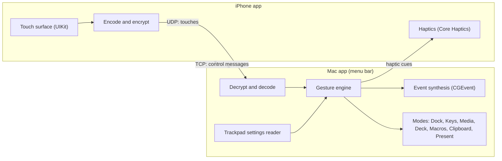

# Architecture

Glasspad is a phone that sends touches and a Mac that turns them into input. The full contract is in [docs/SPEC.md](docs/SPEC.md). This page is the short version.

## Pieces

| Folder | What it holds |
| --- | --- |
| `Packages/GlasspadKit` | Shared code for both apps: wire messages, encryption, networking, touch model and gesture recognizer. |
| `Packages/GlasspadMacCore` | Mac-only logic: settings reader, event synthesis, server, and the modes. |
| `Apps/Mac` | Thin menu bar app around GlasspadMacCore. |
| `Apps/iOS` | Thin iPhone app: SwiftUI shell and a UIKit touch view. |
| `scripts` | `test.sh` runs all package tests, `build-mac.sh` builds the Mac app without Xcode, `make-icons.swift` redraws the icons. |

The apps are kept thin on purpose. Logic lives in the packages so it can be tested from the command line.

## Connection

1. The Mac advertises itself on the local network with Bonjour (automatic discovery, no addresses to type).
2. The phone finds its paired Mac and opens a TCP connection for control messages, then both sides swap random values and derive a session key.
3. Touches travel over UDP (faster, no waiting for lost packets). Control messages, settings, modes and pings travel over TCP.
4. While the trackpad is on screen the phone sends a tiny heartbeat so the Wi-Fi radio does not fall asleep between touches.
5. The connection reconnects by itself if it drops.

## Gestures

The gesture recognizer runs on the Mac, which is the source of truth for what happens. The same code runs on the phone, fed only by local touches, to trigger haptics with no network delay. Every threshold lives in one file, `GestureTuning.swift`.

## Mac side input

Pointer, clicks and scrolling use public `CGEvent` calls. Spaces, Mission Control and pinch gestures need private event fields. Each private call has a public fallback (for example Control plus an arrow key for Spaces), and a self-check at launch switches to the fallback if the private call is not available. The menu shows which is which.

## Testing

Tests use swift-testing and run with `scripts/test.sh`. Tests never post events into the live session: they build events and check their fields. A loopback test pairs a client and a server in one process and checks that touch frames arrive.

What only the real Mac can show (Control Center, Night Shift, window moves, display changes) is covered by the live check, run by hand with `scripts/live-check.sh`: Glasspad started with `--live-check` runs each feature through `DeckMode` and `ModeRouter`, the paths the phone uses, and puts the Mac back after each one (`Packages/GlasspadMacCore/Sources/GlasspadMacCore/LiveCheck`). Its state reading and restoring is tested with a fake Mac. See [docs/LIVE-CHECK.md](docs/LIVE-CHECK.md).
