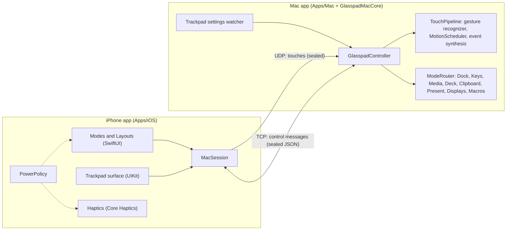
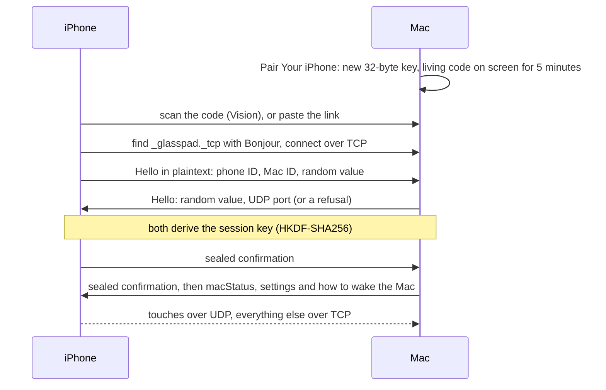

# Architecture

Glasspad is an iPhone app and a Mac menu bar app on the same Wi-Fi. The phone draws the controls and sends touches and requests; the Mac turns them into pointer movement, keystrokes and actions. The full contract is in [docs/SPEC.md](docs/SPEC.md). This page is the short version of how the system is built today.

## Packages

The apps are kept thin on purpose. Logic lives in Swift packages so it can be tested from the command line.

| Folder | What it holds |
| --- | --- |
| `Packages/GlasspadKit` | Shared by both apps (iOS 17+, macOS 14+): wire messages, encryption, transport, the touch model and gesture recognizer, and the pure rules behind the phone's screens: Layouts, themes, `PowerPolicy`, StandBy, the Remote keymap, Displays geometry, tile grids, the living pairing pattern, website icon parsing. |
| `Packages/GlasspadMacCore` | Mac only: trackpad settings reader, event synthesis, the server and pairing, the mode handlers, Mac controls and window tiling. |
| `Packages/GlasspadMacros` | Mac only: macro recording and playback, Shortcuts, per-app profiles, triggers and the starter library. |
| `Apps/Mac` | The menu bar app: popover, Settings window, first-run assistant, pairing code. A SwiftPM package, so it builds without Xcode. `Helpers/NowPlayingHelper.m` reads now playing (see Modes below). |
| `Apps/iOS` | The iPhone app (iOS 18+): `App`, `Design`, `Layouts`, `Link`, `Modes`, `Pairing`, `Settings`, `Setup`, `Trackpad`, plus Siri and Shortcuts actions (`Intents`), the Live Activity (`Live`) and the widgets extension (`Widgets`). |
| `scripts` | Install, build, test and renewal scripts (see [CONTRIBUTING.md](CONTRIBUTING.md)). |
| `web`, `promo` | The website and the demo film. Not part of the apps. |

`project.yml` describes the Xcode project for XcodeGen, which generates `Glasspad.xcodeproj` (schemes `Glasspad iOS` and `Glasspad Mac`).

## Connection and pairing

- **Pairing pattern.** The code on the Mac is a real QR code drawn as soft dots that drift (`PairingPattern` in GlasspadKit). The phone reads it with Vision (`PairingCodeReader`), and the same model lets both sides gather the dots into a check when pairing finishes. Tests render the moving pattern and read it back. Copy Link and Share send the same `glasspad://pair` link to a phone that cannot scan.
- **Keys.** The pairing key lives in the Keychain on both devices. Each connection derives a fresh session key; every frame is sealed with ChaCha20-Poly1305 and replays are rejected.
- **Network.** The phone looks for the Mac on the shared Wi-Fi first and allows peer-to-peer Wi-Fi only after 3 seconds, because it adds latency spikes. It reconnects by itself, can wake a sleeping Mac with Wake-on-LAN, and remembers several Macs.
- **Keep-awake heartbeats.** While a trackpad shows, the phone sends a tiny packet every 20 ms between touches so the Wi-Fi radio does not doze.

## Modes

Each phone screen is an `AppMode`. The Mac follows them through `ModeMessage` (JSON with a `"t"` field, inside the sealed control channel).

| Mode | Phone | Mac |
| --- | --- | --- |
| Trackpad | UIKit surface at 120 Hz, finger dots, haptics | Gesture recognizer, display-synced `MotionScheduler`, `CGEvent` and private gesture events with public fallbacks |
| Keyboard | Text streamed as you type or dictate, modifiers, arrows, F1 to F12 | Unicode key events; shortcuts pressed on the key the Mac's keyboard layout uses |
| Media | Now playing, scrubbing, sound output, volume, brightness | MediaRemote through a helper (macOS 15.4 and later answer only Apple processes), AppleScript for Spotify and Music, CoreAudio |
| Dock | The Mac's Dock in order, running dots, hold for Quit or Hide | Dock prefs and NSWorkspace, 384 px icons sent once, hide the Mac's own Dock |
| Actions | Buttons for the app in front, Pinned, folders, the Library | `DeckMode` runs each action directly; the config lives on the Mac |
| Remote | Touch pad, keys that follow the player, Search, quick Mac controls | Media commands, seeking, keystrokes, `remoteSystem` |
| Present | Next and Back, timer, laser | Arrow keys and a transparent overlay for the laser |
| Clipboard | Text and images both ways | NSPasteboard; text over 2 MB is refused whole, never cut |
| Displays | Displays and windows as System Settings draws them | Window server list, moves through Accessibility, display changes with Keep or Revert |
| Clock, Now Playing, Calendar | StandBy screens for layouts: always black, dim red at night | Now Playing uses the Media stream; the others need nothing from the Mac |

Remote, Displays, Clipboard and Present start as tools in the mode menu; Settings can show them as modes. Actions can be split back into Deck and Macros.

## Layouts

A layout shows one to three modes on one screen. The model is in GlasspadKit (`Layouts/`), the views in `Apps/iOS/Sources/Layouts`.

- `ScreenLayout`: panes by mode name, a split direction (automatic, side by side or stacked), and the shares of the main and inner split. A mode never shows twice. Modes from a newer build survive saving.
- `DividerMath`: the line rests on thirds and the middle, resists past a 120 pt minimum, and folds a pane away when pulled further.
- `LayoutTemplate.builtIn`: Desk, Type, Listen and Couch come with a new install. Trackpad and Dock, Media and Actions, Studio, Presenter, StandBy, and Clock and Trackpad are in the gallery.
- `LayoutWirePlan`: the Mac follows one screen at a time, so a layout reports its most demanding pane with `modeSelected`, then lists every pane with `modesShown`. An older Mac ignores `modesShown`; a Dock pane then asks for its list every 3 seconds.
- `ShownCount`: views that can show in more than one pane (the trackpad, the diagnostics) are counted, so when one replaces another the new one is never switched off.

## Themes

`ThemeCatalog` in GlasspadKit holds every theme as plain data: 27 themes plus Photo, in four groups.

- **Classic:** System, Paper, Graphite, Mono, Pure Black, High Contrast.
- **Glass:** Glass, Glass Dark, Clear, Aurora, Ocean, Dusk, Rose, Mint, Lavender, Ember, Citrus, Smoke.
- **Color:** Sand, Midnight, Forest, Plum, Slate, Espresso, Solar, Frost, Dawn.
- **Photo:** a picked photo, blurred and veiled (`PhotoTone`) so text reads on it.

Each theme defines every color, its own accent included. `ThemeContrastTests` checks text, accents, button labels and status colors against WCAG AA (the web's accessibility contrast standard) on every surface. Views read colors only through `Palette` (`Apps/iOS/Sources/Design/Theme.swift`). Remote and StandBy stay dark.

## Power

`PowerPolicy` (GlasspadKit) turns the phone's heat and Low Power Mode into rules, and `PowerMonitor` keeps it current in the app. What the person is doing is never slowed; only extras give way.

- **Warm** (thermal state serious or worse): haptics and heartbeats pause, decorative motion stops, and a short notice says so.
- **Low Power Mode or fair heat:** decorative motion at 30 frames a second. Low Power Mode also scrolls long titles once instead of three times, redraws progress once a second, and stops heartbeats after 10 s without a touch.
- **Keep Screen On** holds the screen only for the trackpad or Present, only while connected, with nothing on top, and only until the phone is left alone (10 minutes, less when warm or saving power).
- **StandBy screens** keep the screen on while charging (or on battery when asked, never in Low Power Mode) and never once the phone is warm.

## Protocol additions

All of these are additive: an older build drops what it does not know and keeps the session (`ControlMessage.unknown`).

- **Remote:** `modeSelected(.remote)` makes the Mac send now playing and the front app. `remoteSystem(id:action:)` runs one Mac control without a Deck button and is answered with `deckResult`, including a switch's new state ("Do Not Disturb is on").
- **Displays:** `displaysWatch(on:)` starts `displaysState` updates, read four times a second while watched. `windowCommand` and `displayCommand` are answered with `displaysResult`. Tile and move frames come from one shared function, so the phone shows the result before the Mac confirms.
- **modesShown:** every pane of a layout, so the front app and Dock changes reach the panes that show them.
- **Lenient Deck decoding:** a Deck action from a newer build decodes as `DeckAction.unsupported` with its raw JSON and is written back unchanged. Lists skip only an element that cannot be read at all. The phone shows such a button as "Update Glasspad to use this"; the Mac refuses to run or add it.
- **macStatus:** Accessibility and Automation state, sent after the handshake and on every change.

## Mac controls

Mac controls are `DeckSystemAction` cases. `DeckSystemCatalog` gives each one its title, symbol, color and Library group, so the phone lists new ones without a table of its own.

- **Do Not Disturb:** presses the switch in Control Center (or the Focus menu) through Accessibility, found by stable identifiers, so it works in every language. Falls back to a shortcut the person already has.
- **Night Shift:** CoreBrightness `CBBlueLightClient`.
- **Keep Awake:** a power assertion that stops the display from sleeping.
- **Window tiling:** Left, Right, Top and Bottom Half, Fill, Center, Split Screen and Next Display set window frames through Accessibility inside the screen's visible area, with the 8 pt gap when "Tiled windows have margins" is on. Falls back to the app's Window menu.

## Starter library

`StarterLibrary` (GlasspadMacros) ships buttons for 74 apps plus an Everywhere set. Each button is one of the app's own documented shortcuts or a Mac control. The library has a version number (now 2), and `StarterHistory.swift` keeps every shipped version. When a Mac has older starters, `StarterSeeder.upgrade` updates the ones the person never touched, keeps edited ones as they are, keeps deleted ones deleted, and adds new apps.

## Mac side input

Pointer, clicks and scrolling use public `CGEvent` calls. Spaces, Mission Control and pinch need private event fields. Each private call has a public fallback (for example Control plus an arrow key for Spaces), a self-check at launch switches to it when needed, and the Mac's Settings > Trackpad lets the person choose per gesture.

## Testing

- `scripts/test.sh` runs every package's tests (swift-testing) and the installer tests against fake Apple tools.
- Tests never post events into the live session: they build events and check their fields, or use fakes for the Mac's side effects.
- Phone to Mac session tests send every mode message over a real sealed loopback session through the real router.
- `Apps/Mac` has its own tests: the Mac's wording, and a test that renders the living pairing code and reads it back with Vision. A snapshot harness draws every Mac screen to PNGs when asked.
