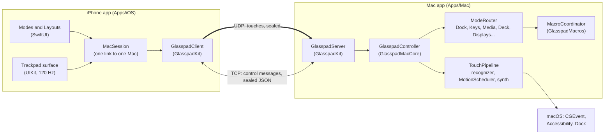
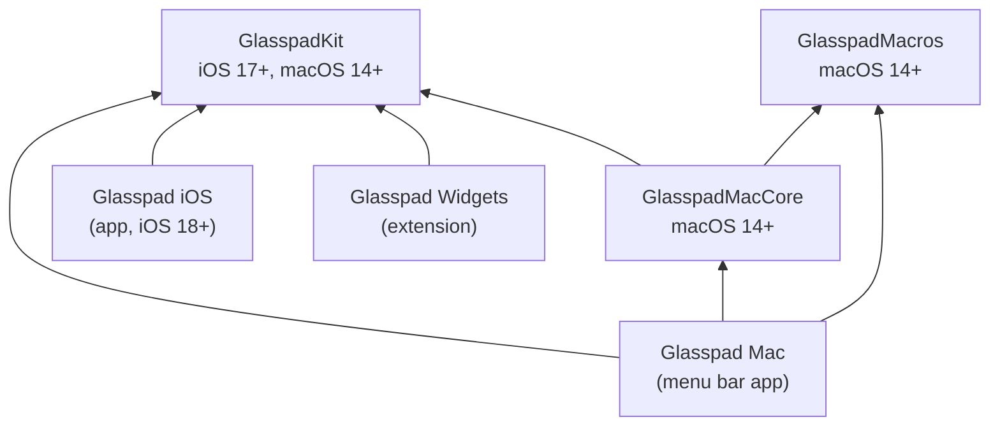
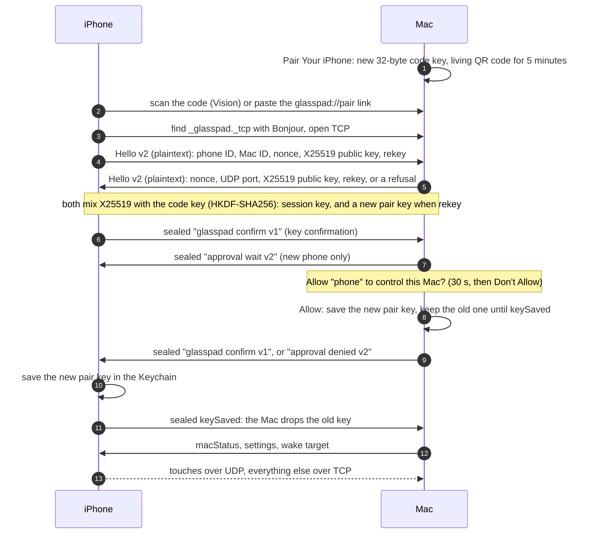
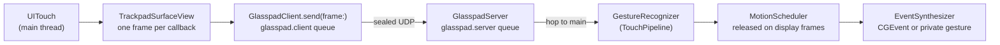
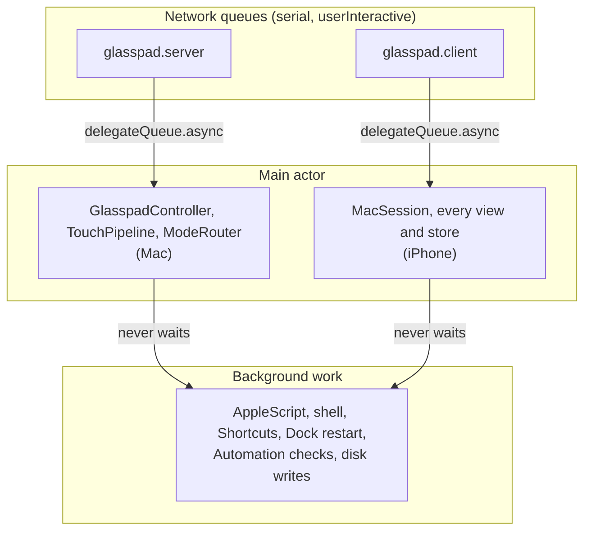

# Architecture

Glasspad is two apps on the same Wi-Fi. The **iPhone app** draws the controls and sends touches and requests. The **Mac menu bar app** turns them into pointer movement, keystrokes and actions. Almost all logic lives in three Swift packages, so it can be tested from the command line.

| Read this for | Go to |
| --- | --- |
| The exact wire format and every message | [docs/SPEC.md](docs/SPEC.md) |
| What each mode does, in plain words | [docs/how-it-works.md](docs/how-it-works.md) |
| Why a design choice was made | [docs/adr/](docs/adr/README.md) |
| Words used here | [docs/glossary.md](docs/glossary.md) |

## Contents

- [The system at a glance](#the-system-at-a-glance)
- [Packages and targets](#packages-and-targets)
- [The wire: two channels](#the-wire-two-channels)
- [Pairing and encryption](#pairing-and-encryption)
- [The path of a touch](#the-path-of-a-touch)
- [Threading and the main-thread rule](#threading-and-the-main-thread-rule)
- [Staying compatible across versions](#staying-compatible-across-versions)
- [Private macOS calls](#private-macos-calls)
- [Where state is stored](#where-state-is-stored)
- [Folder map](#folder-map)

## The system at a glance



- **No server, no account.** The phone finds the Mac with Bonjour (`_glasspad._tcp`) and talks to it directly.
- **One phone at a time.** A new phone that proves its key replaces the old session.
- **The Mac decides what the pointer does.** The phone runs the same gesture recognizer only to play haptics instantly.

## Packages and targets



| Folder | What it holds | Tests |
| --- | --- | --- |
| `Packages/GlasspadKit` | Shared by both apps. Wire messages, encryption, transport, the touch model and gesture recognizer, and the pure rules behind the phone's screens: layouts, themes, `PowerPolicy`, StandBy, the Remote keymap, Displays geometry, tile grids, the living pairing code, website icon fetching. | `Tests/GlasspadKitTests` |
| `Packages/GlasspadMacCore` | Mac only. Trackpad settings reader, event synthesis, the controller, pairing, every mode handler, Mac controls, window tiling, the live check. | `Tests/GlasspadMacCoreTests` |
| `Packages/GlasspadMacros` | Mac only, depends on nothing in the repo. Macro recording and playback, Shortcuts, per-app profiles, triggers, the starter library. Spec: [docs/SPEC-macros.md](docs/SPEC-macros.md). | `Tests/GlasspadMacrosTests` |
| `Apps/Mac` | The menu bar app: popover, Settings, first-run assistant, pairing code view. A SwiftPM package, so it builds without Xcode. `Helpers/NowPlayingHelper.m` reads now playing ([ADR 0003](docs/adr/0003-now-playing-through-perl.md)). | `Tests/GlasspadMacSnapshots` |
| `Apps/iOS` | The iPhone app (`Sources/`), the widgets extension (`Widgets/`) and code both share (`Shared/`). | Visual check in the simulator |

`project.yml` describes the Xcode project for [XcodeGen](https://github.com/yonaskolb/XcodeGen). `xcodegen generate` makes `Glasspad.xcodeproj` (not committed) with the schemes **Glasspad iOS** and **Glasspad Mac**. Both apps build with Swift 6 and complete strict concurrency checking.

## The wire: two channels

| | TCP control channel | UDP touch channel |
| --- | --- | --- |
| Carries | Everything except touches: settings, mode messages, pings, status | Touch snapshots and keep-awake heartbeats |
| Format | `UInt32` big-endian length, then a sealed JSON frame (`ControlMessage`, whose `"t"` field names the case) | One sealed binary packet (`TouchCodec`: 18-byte header plus 8 bytes per finger) |
| Size limit | 16 MiB per frame (8 KiB before the handshake ends) | Up to 10 fingers |
| Network options | `noDelay`, `.responsiveData` | `.interactiveVoice` (the Wi-Fi voice queue) |
| Lost data | TCP resends | Each packet lists every finger down, so the next one heals a loss |

Timings, all in `GlasspadService` (`Transport/Link.swift`) and `ReconnectBackoff`:

| What | Value |
| --- | --- |
| Mac pings the phone | every 1 s |
| Phone gives up on a silent Mac and reconnects | 3.5 s |
| Mac closes a silent phone's session | 6 s |
| Keep-awake heartbeat while a trackpad shows | every 20 ms between touches |
| Shared Wi-Fi before peer-to-peer Wi-Fi is tried | 3 s ([why](docs/glossary.md#awdl)) |
| Reconnect waits | 0.2, 0.5, 1, 2, then 5, 10, 30 s with jitter |

## Pairing and encryption



| Piece | How | Code |
| --- | --- | --- |
| Pairing link | `glasspad://pair?v=1&id=<macID>&name=<name>&k=<base64url key>` | `Crypto/PairingPayload.swift` |
| Code lifetime | 5 minutes, checked by the server on the wall clock, then the code key is disarmed and the Mac shows Code Expired | `PairingFlow.codeLifetime`, `GlasspadServer.armPairing(key:expiresAt:)` |
| Living code | A real QR code drawn as drifting dots. Tests render it and read it back with Vision. | `Pairing/PairingPattern.swift`, `PairingCodeReader.swift` |
| Key agreement | A fresh X25519 key pair per connection, mixed with the pair key. On the first connection (rekey) both sides derive a new pair key, so the code is useless afterwards. | `Crypto/KeyAgreement.swift` |
| Allow | A new phone waits while the Mac asks Allow or Don't Allow. Return does not answer it; no answer in 30 s counts as Don't Allow. | `GlasspadServer`, `ApprovalPrompt.swift` |
| Key storage | Keychain on both devices (`AfterFirstUnlockThisDeviceOnly`). The Mac keeps the old key until the phone sends keySaved. | `PairingStore` (Mac), `KnownMacsStore` (phone) |
| Session key | `HKDF-SHA256(X25519 + pairKey, salt: phoneNonce + macNonce, info: "glasspad v2 session" + rekey + both public keys)` | `Crypto/KeyAgreement.swift`, `Crypto/SessionCrypto.swift` |
| Old peers | A 0.2.x peer already paired still connects with protocol 1 (`"glasspad v1 session"`, no key exchange). New pairings need both sides on protocol 2. | [protocol.md](docs/security/protocol.md#3a-protocol-1-and-old-installs) |
| Sealing | ChaCha20-Poly1305. The nonce is a 4-byte direction tag plus an 8-byte counter. | `SessionCrypto` |
| Replays | TCP counters must rise. UDP accepts a 64-wide sliding window and rejects duplicates. | `SessionCrypto.openUDP` |
| Bad frames | Dropped silently and counted (`LinkStats.authFailures`, `replayDrops`) | `GlasspadServer` |

The two Hellos (or the Mac's refusal) are the only plaintext, and they hold no secret. Threat model and how to report a problem: [SECURITY.md](SECURITY.md).

## The path of a touch



1. **Phone.** The UIKit surface reads touches at 120 Hz and sends one full snapshot per touch callback. While a finger rests, it resends the snapshot every 20 ms.
2. **Mac, recognizer.** `GestureRecognizer` turns snapshots into events: move, click, scroll, pinch, swipe. It follows the Mac's own trackpad settings and pointer acceleration curve (`Gestures/MacAcceleration.swift`). Every threshold lives in `GestureTuning.swift`.
3. **Mac, scheduler.** `MotionScheduler` holds events briefly and releases at most one move, drag and scroll per display frame. This turns Wi-Fi bunching into smooth motion and bridges short radio gaps.
4. **Mac, synthesis.** `EventSynthesizer` posts public `CGEvent`s for pointer, clicks and scroll, and private gesture events for Spaces, Mission Control and pinch, each with a public fallback.

Haptics play on the phone from its own recognizer, so a click is felt without waiting for the network.

## Threading and the main-thread rule



| Rule | Why |
| --- | --- |
| Transport classes are thread safe and call their delegate on `delegateQueue` (the main queue in both apps). | One place to hop threads. |
| App state is `@MainActor`: `GlasspadController`, `TouchPipeline`, `ModeRouter` on the Mac, `MacSession` on the phone. | Swift 6 strict concurrency checks it when compiling. |
| **Main-thread rule:** code on the main thread never makes a call that can block: no `waitUntilExit`, semaphore or group `wait`, `Thread.sleep`, `sleep`, or `AEDeterminePermissionToAutomateTarget`. | The menu bar icon froze once when an Automation permission check ran on the main thread ([ADR 0004](docs/adr/0004-main-thread-never-blocks.md)). |
| `scripts/check-main-thread.py` enforces it in every test run. Reviewed exceptions go in `scripts/main-thread-allowlist.txt` with a reason. | So it cannot come back. |
| `keyLookup` and `saveKey` run on the server's own queue and must not call back into the server. | Avoids a deadlock. |

## Staying compatible across versions

A phone and a Mac often run different builds, so every protocol change is **additive**.

- A message type this build does not know decodes as `ControlMessage.unknown` and is ignored. The session stays up.
- New fields are optional. Unknown fields are ignored.
- A Deck action from a newer build decodes as `DeckAction.unsupported`, keeps its raw JSON, and is written back unchanged. The Mac never runs it.
- `WireGoldenTests` keeps every message as an older release wrote it, and checks it still reads and writes the same ([ADR 0005](docs/adr/0005-additive-protocol-and-frozen-wire.md)).

## Private macOS calls

The Mac app is not sandboxed and not on the App Store, so it may use undocumented macOS calls. Each one has a public fallback or a clear message, and is checked at run time. The phone uses public iOS APIs only.

| Feature | Private path | Fallback |
| --- | --- | --- |
| Spaces, Mission Control, pinch, rotate | CGS gesture events (`Synth/CGSPrivate.swift`), checked at launch by `SynthCapabilities` | Keyboard shortcuts, such as Control plus an arrow key. The person can choose per gesture in Settings > Trackpad. |
| Mission Control, App Exposé, Show Desktop buttons | `CoreDockSendNotification`, the call the Dock's own keys make ([ADR 0002](docs/adr/0002-mission-control-through-the-dock.md)) | Launch Services, then the Mission Control program |
| Now playing | MediaRemote, through a helper loaded by `/usr/bin/perl` ([ADR 0003](docs/adr/0003-now-playing-through-perl.md)) | MediaRemote in process (before macOS 15.4), then AppleScript for Spotify and Music |
| Night Shift | CoreBrightness `CBBlueLightClient` | Says "Night Shift is not available on this Mac" |
| Do Not Disturb | Presses the Control Center switch through Accessibility, found by stable identifiers | A keyboard shortcut the person already has |

## Where state is stored

| What | Where |
| --- | --- |
| Pairing keys | Keychain on both devices |
| Mac app preferences (gesture choices, trackpad tuning) | `UserDefaults` of `com.soham109.glasspad` |
| Deck buttons | `~/Library/Application Support/Glasspad/deck.json` |
| Install and renewal state | `~/Library/Application Support/Glasspad/`: `phone-install.env`, `refresh-status.json`, `phone-session.json` |
| Logs | Unified log, subsystem `com.soham109.glasspad`. Renewal: `~/Library/Logs/Glasspad/refresh.log`. Live check: `~/Library/Logs/Glasspad/live-check-<date>.md`. |
| Phone layouts, theme, settings | `UserDefaults` on the iPhone |

## Folder map

```
glasspad/
  Apps/iOS/        Sources/{App, Design, Intents, Layouts, Link, Live, Modes, Pairing,
                   Settings, Setup, Trackpad}, Shared/, Widgets/
  Apps/Mac/        Sources/Glasspad/, Helpers/NowPlayingHelper.m, Tests/GlasspadMacSnapshots/
  Packages/GlasspadKit/       Protocol, Crypto, Transport, Gestures, Pairing, Layouts, Theme,
                              Power, StandBy, Remote, Displays, Keys, Media, Web, ...
  Packages/GlasspadMacCore/   Server, Synth, Modes, Settings, Macros, LiveCheck, Install
  Packages/GlasspadMacros/    Model, Recording, Playback, Profiles, Triggers, Apple, System
  Config/Mac/      Info.plist and entitlements for the Xcode build of the Mac app
  scripts/         build, install, test, renewal, visual and live checks
  docs/            developer documentation (start at docs/README.md)
  web/, promo/     the website and the demo film (not part of the apps)
  install.sh       the one-line installer
  project.yml      XcodeGen project for both apps
```
