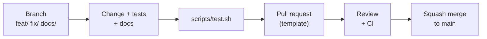

# Contributing

Thanks for helping. Small, focused changes are the easiest to review.

| You want to | Go to |
| --- | --- |
| Ask a question or get help | [SUPPORT.md](SUPPORT.md) |
| Report a bug or ask for a feature | [Issues](https://github.com/Soham109/glasspad/issues) (use the forms) |
| Report a security problem | [SECURITY.md](SECURITY.md), privately |
| Build and run the apps | [docs/development.md](docs/development.md) |
| Understand the code | [ARCHITECTURE.md](ARCHITECTURE.md) |
| Write or change docs | [docs/CONTRIBUTING-DOCS.md](docs/CONTRIBUTING-DOCS.md) |

Everyone taking part follows the [Code of Conduct](CODE_OF_CONDUCT.md).

## Quick start

```bash
git clone https://github.com/Soham109/glasspad.git
cd glasspad
scripts/test.sh          # every package's tests, the installer tests, the main-thread check
scripts/build-mac.sh     # builds build/Glasspad.app (does not launch it)
xcodegen generate        # makes Glasspad.xcodeproj for the iPhone app
```

Full setup, including the iPhone app and the simulator: [docs/development.md](docs/development.md).

## Workflow



### Branches

| Prefix | For | Example |
| --- | --- | --- |
| `feat/` | New behavior | `feat/remote-subtitles` |
| `fix/` | A bug fix | `fix/pairing-expiry` |
| `docs/` | Documentation only | `docs/testing-guide` |

Branch from `main`. Never push to `main` directly.

### Commit messages

Match the existing history: `Area: what changed, and why if it is not obvious`.

```text
Installer: fix Developer Mode hang for every user, headless runs, team selection, verified downloads
Mac app: never wait on the Automation permission check on the main thread (menu bar icon froze while Media polled Spotify or Music)
Web: a link to Troubleshooting or Uninstall on the install page opens that section
```

- Common areas: `Mac app`, `Phone`, `Trackpad`, `Link`, `Installer`, `Tests`, `CI`, `Docs`, `Web`.
- One short summary line. Use semicolons to list several related changes.
- No `Co-Authored-By` lines and no tool attribution (no "Generated with ..." footers).

Pull requests are squash merged, so the pull request title becomes the commit on `main`. Write it the same way.

## Definition of done

A change is done when every box applies or does not need to:

- [ ] `scripts/test.sh` passes (CI runs it on every push and pull request).
- [ ] The Mac app builds: `scripts/build-mac.sh`.
- [ ] The iPhone app builds: the **Glasspad iOS** scheme in Xcode, or `scripts/visual-check.sh` (see [testing](docs/testing.md)).
- [ ] New behavior has a test. Gesture changes need a scripted touch sequence test.
- [ ] UI changes have screenshots or a short recording in the pull request.
- [ ] `CHANGELOG.md` has an entry under `## [Unreleased]` if people will notice the change.
- [ ] Docs are updated in the same pull request: [docs/SPEC.md](docs/SPEC.md) for any interface change, and the relevant page in [docs/](docs/README.md).

## Review rules

| Change touches | Needs |
| --- | --- |
| Trackpad feel, gestures or haptics (`Gestures/`, `GestureTuning.swift`, `TouchPipeline`, `MotionScheduler`, `Haptics.swift`) | The maintainer's review, and a note at the top of the pull request |
| The wire (`Protocol/`, `Transport/`, `Crypto/`) | Additive only. An older phone or Mac must ignore it and keep the session. `WireGoldenTests` must pass unchanged. |
| A private macOS call | A public fallback and a run-time check |
| The installer or renewal scripts | A case in `scripts/tests/installer-test.sh` |
| Anything else | One approving review and green CI |

## Code rules

- Tests never post events into the live session. Build events and check their fields, or use the fakes.
- Code on the main thread never blocks ([ADR 0004](docs/adr/0004-main-thread-never-blocks.md)). `scripts/check-main-thread.py` checks it.
- Gesture thresholds live in `GestureTuning.swift`, not in the code that uses them.
- Only public iOS APIs on the phone.
- Views take colors from `Palette`, never hard-coded.
- Do not copy code from projects with incompatible licenses.

## Style for words in the app and the docs

- Plain words, US English. Explain any technical term where you first use it.
- Use the names macOS uses: Do Not Disturb, Mission Control, Split Screen.
- No em dashes or en dashes.
- Keep the interface minimal. No extra chrome on the trackpad screen.

## Releases

The maintainer cuts releases. In short: move the `Unreleased` entries into a new version section, set the version in `project.yml`, `CITATION.cff` and `web/site/pages.ts`, tag `vX.Y.Z` and publish a GitHub release with that section as its notes. Every step: [docs/releasing.md](docs/releasing.md).

## License

By contributing you agree your work is released under the [MIT license](LICENSE).
