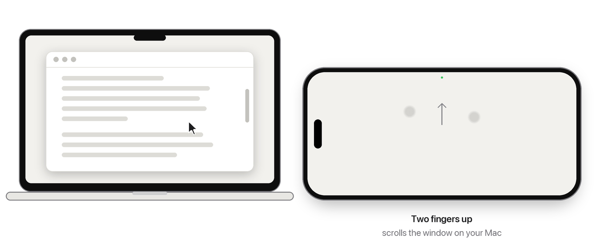
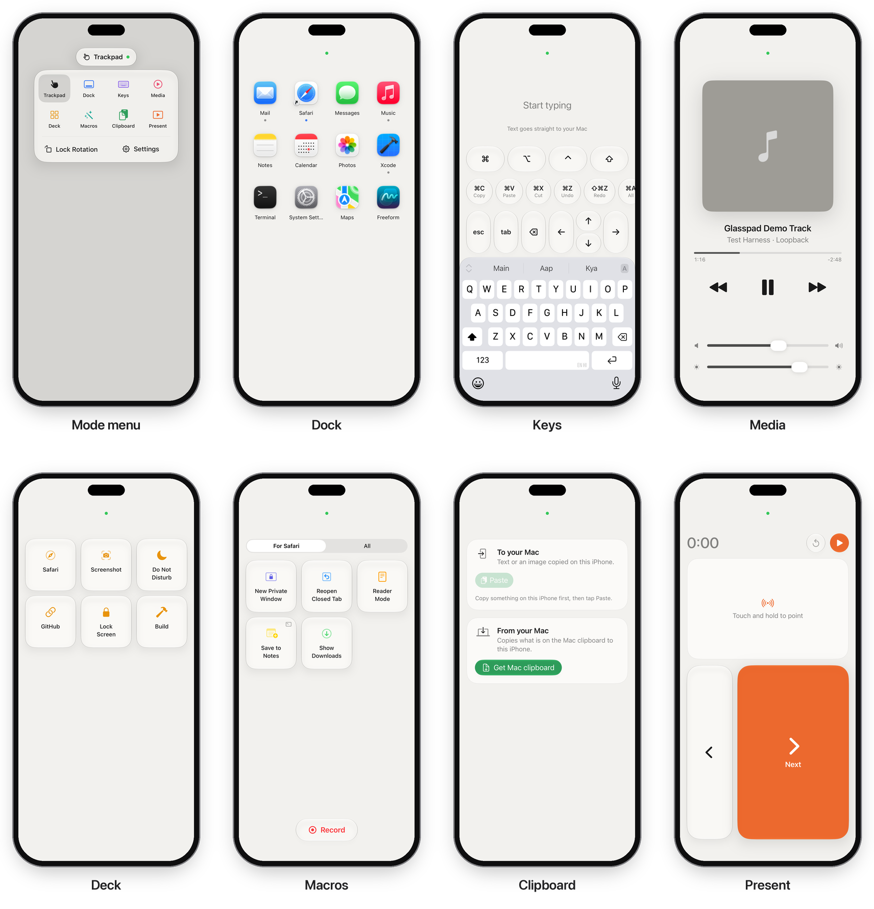

<h1 align="center">Glasspad</h1>

<p align="center"><b>Your iPhone, as a Mac trackpad</b></p>

<p align="center">
A wireless trackpad you can feel, plus seven more modes. Private, free and open source.
</p>

<p align="center">
  
  
  
  
</p>

<p align="center">
  
</p>

<p align="center">
  <picture>
    <source media="(prefers-color-scheme: dark)" srcset="docs/img/hero-dark.png">
    <source media="(prefers-color-scheme: light)" srcset="docs/img/hero-light.png">
    
  </picture>
</p>

---

## What it is

Your iPhone becomes a wireless trackpad for your Mac, with a small tap you can feel on every click. Two apps on the same Wi-Fi: a menu bar app on the Mac and the trackpad app on the phone.

- **Private.** No accounts, no servers, no tracking. Nothing leaves your network.
- **Free and open source.** MIT licensed. No subscription.
- **Built from source.** That is what lets the Mac side do real Mission Control and Spaces swipes.

## Trackpad

- Move, click, right click, drag, scroll with momentum, pinch, rotate, smart zoom.
- Swipe between pages and Spaces, Mission Control, App Exposé, Launchpad, Show Desktop.
- Hold still for a force click (a phone cannot sense pressure).
- Upright or sideways, with a rotation lock in the mode menu.
- Gestures and speed follow your Mac's own trackpad settings.

## Modes

Tap the pill at the top of the phone to switch.

| Mode | |
| --- | --- |
| **Dock** | Open or switch Mac apps. |
| **Keys** | Type and dictate on the phone; arrows and shortcuts. |
| **Media** | Now playing, volume, brightness. |
| **Deck** | Your own buttons: apps, links, Shortcuts, keystrokes, scripts. |
| **Macros** | Record and replay. Follows the front app. |
| **Clipboard** | Copy between phone and Mac. |
| **Present** | Next, previous, timer, laser dot. |

<p align="center">
  <picture>
    <source media="(prefers-color-scheme: dark)" srcset="docs/img/modes-dark.png">
    <source media="(prefers-color-scheme: light)" srcset="docs/img/modes-light.png">
    
  </picture>
</p>
<p align="center"><sub>Simulator screenshots against a stand-in Mac. The album art is a placeholder.</sub></p>

## Security

- Pair by scanning a QR code. The key lives in the Keychain on both devices.
- Every message is encrypted (ChaCha20-Poly1305) with a fresh key per connection, and replays are rejected.
- Remove a phone from the Mac menu to revoke it.

More in [SECURITY.md](SECURITY.md) and [ARCHITECTURE.md](ARCHITECTURE.md).

## Install

You need Xcode 26 and an iPhone on iOS 18 or newer.

```bash
git clone https://github.com/Soham109/glasspad.git
cd glasspad
brew install xcodegen && xcodegen generate
open Glasspad.xcodeproj
```

1. Run the **Glasspad Mac** scheme. Allow Accessibility when asked.
2. Run the **Glasspad iOS** scheme on your iPhone (set your Apple ID under Signing).
3. In the Mac menu bar, choose Pair and scan the code with the phone.

With a free Apple ID the phone app expires after 7 days; run it from Xcode again. Mac app without Xcode: `scripts/build-mac.sh`.

## FAQ

**Over the internet?** No. Same Wi-Fi only.

**How fast is it?** Built for low delay. Numbers will be published once measured on real devices.

**Why not the App Store?** Real gestures need private macOS interfaces. Each has a public fallback.

**Can others on my Wi-Fi use it?** Not without the key from your QR code.

**More than one Mac or iPhone?** Pair several Macs and pick one from the mode menu. A Mac follows one iPhone at a time.

## Roadmap

- [ ] First tagged release (0.1.0)
- [ ] Measured latency numbers on real hardware
- [ ] Signed and notarized Mac download
- [ ] More Deck actions and shareable macro files
- [ ] iPad support
- [ ] Pointer gain and acceleration tuning presets

## Contributing

Bug reports, ideas and pull requests are welcome. See [CONTRIBUTING.md](CONTRIBUTING.md). To report a security problem, see [SECURITY.md](SECURITY.md).

## License

[MIT](LICENSE), copyright 2026 Soham Aggarwal.
