<p align="center">
  
</p>

<h1 align="center">Glasspad</h1>

<p align="center">
  <b>Your iPhone as a Mac trackpad, keyboard and remote</b><br>
  Glasspad is a free, open source (MIT) app that turns an iPhone into a trackpad, keyboard, media remote and button deck for a Mac, over Wi-Fi, with no account.
</p>

<p align="center">
  <a href="https://github.com/Soham109/glasspad/releases/latest"></a>
  <a href="https://github.com/Soham109/glasspad/actions/workflows/ci.yml"></a>
  <a href="LICENSE"></a>
  
  
</p>

<p align="center">
  <a href="#install"><b>Install</b></a> &nbsp;&middot;&nbsp;
  <a href="https://glasspad.sohamaggarwal.com">Website</a> &nbsp;&middot;&nbsp;
  <a href="https://glasspad.sohamaggarwal.com/guide">Guide</a> &nbsp;&middot;&nbsp;
  <a href="https://www.youtube.com/watch?v=6AArTWOADGc">Video</a> &nbsp;&middot;&nbsp;
  <a href="CHANGELOG.md">Changelog</a>
</p>

<p align="center">
  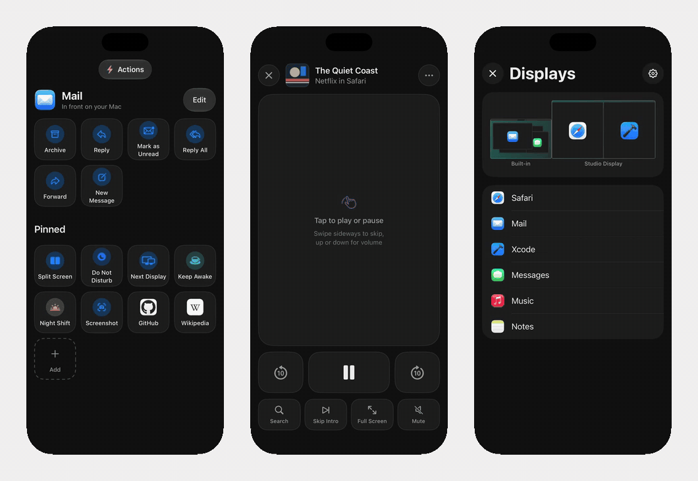
</p>
<p align="center">
  <sub>Actions follow the app in front &nbsp;&middot;&nbsp; Remote for Netflix and YouTube &nbsp;&middot;&nbsp; Displays and windows<br>
  A real recording of the iPhone app in the iOS Simulator, using the app's sample Mac data.</sub>
</p>

## Install

```bash
curl -fsSL https://raw.githubusercontent.com/Soham109/glasspad/main/install.sh | bash
```

Then click Glasspad in the Mac menu bar, choose **Pair Your iPhone…** and scan the code.

To build a fixed release instead of the newest code:

```bash
curl --proto '=https' --tlsv1.2 -fsSL https://raw.githubusercontent.com/Soham109/glasspad/main/install.sh | GLASSPAD_REF=v0.3.0 bash
```

- **You need:** a Mac on macOS 14+, an iPhone on iOS 18+, Xcode 26+ (free), a free Apple ID, and a cable for the first install.
- **What it does:** builds both apps from source with your Apple ID, and waits for you where Apple needs a click (Xcode, Accessibility, Developer Mode). Safe to run again.
- **The 7-day limit:** apps signed with a free Apple ID stop opening after 7 days. Your Mac renews Glasspad over Wi-Fi before then.
- **Free, and the cost:** no fees and no paid Apple account. In return you build it once with Xcode, and the iPhone app is re-signed every 7 days (your Mac does it by itself). There is no App Store, TestFlight or notarized download, because those need Apple's paid developer program.
- **Read it first?** The script is [install.sh](install.sh). The [install page](https://glasspad.sohamaggarwal.com/install) shows every step, with fixes if something goes wrong.

## Features

**11 modes:** Trackpad, Keyboard, Media, Dock, Actions, Pinned, Macros, Clipboard, Present, Remote and Displays.

<table>
  <tr>
    <td align="center" width="33%"><br><b>Trackpad</b><br><sub>Move, click, scroll, pinch and swipe between Spaces, with a tap you can feel on every click.</sub></td>
    <td align="center" width="33%">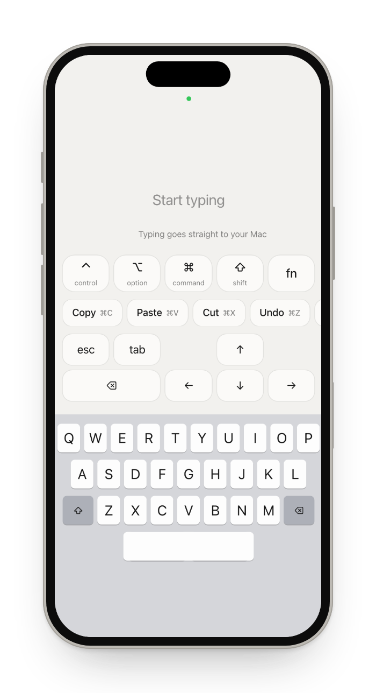<br><b>Keyboard</b><br><sub>Type or dictate, with modifier keys, shortcuts, arrows and F1 to F12.</sub></td>
    <td align="center" width="33%">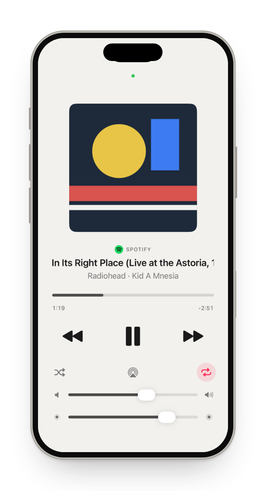<br><b>Media</b><br><sub>What is playing in Spotify, Music, Podcasts or a browser, with artwork, scrubbing, volume and brightness.</sub></td>
  </tr>
  <tr>
    <td align="center">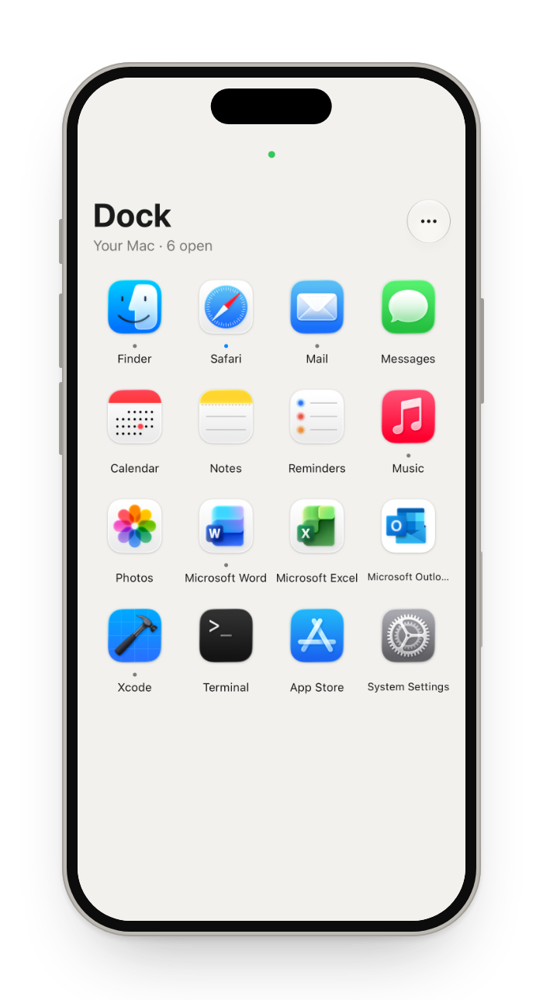<br><b>Dock</b><br><sub>Your Mac's Dock: tap to open, hold to hide or quit.</sub></td>
    <td align="center">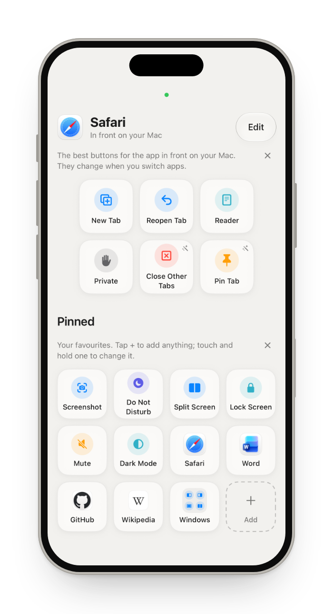<br><b>Actions</b><br><sub>Buttons that follow the app in front, for more than 70 apps.</sub></td>
    <td align="center">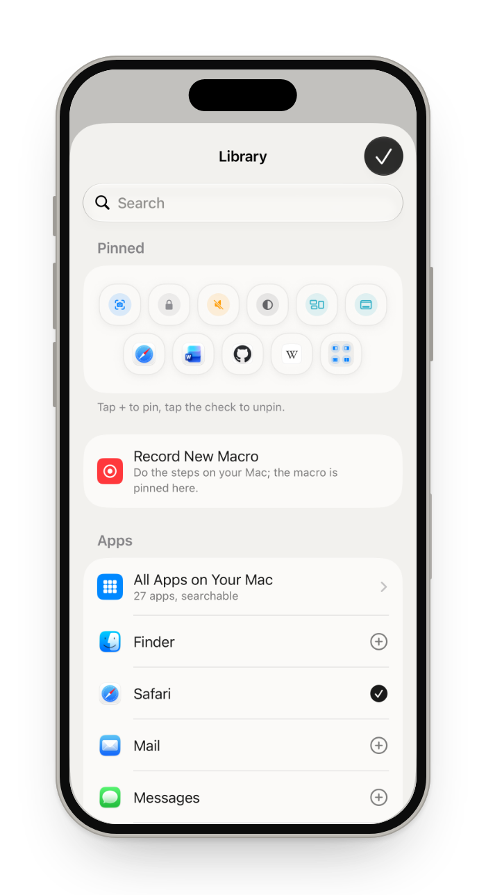<br><b>Pinned</b><br><sub>Your own buttons: apps, websites, shortcuts, window tiling and Mac controls, in folders.</sub></td>
  </tr>
  <tr>
    <td align="center">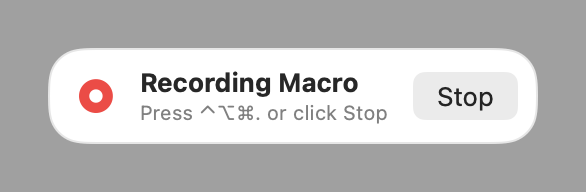<br><b>Macros</b><br><sub>Record steps on your Mac once, replay them with a tap.</sub></td>
    <td align="center">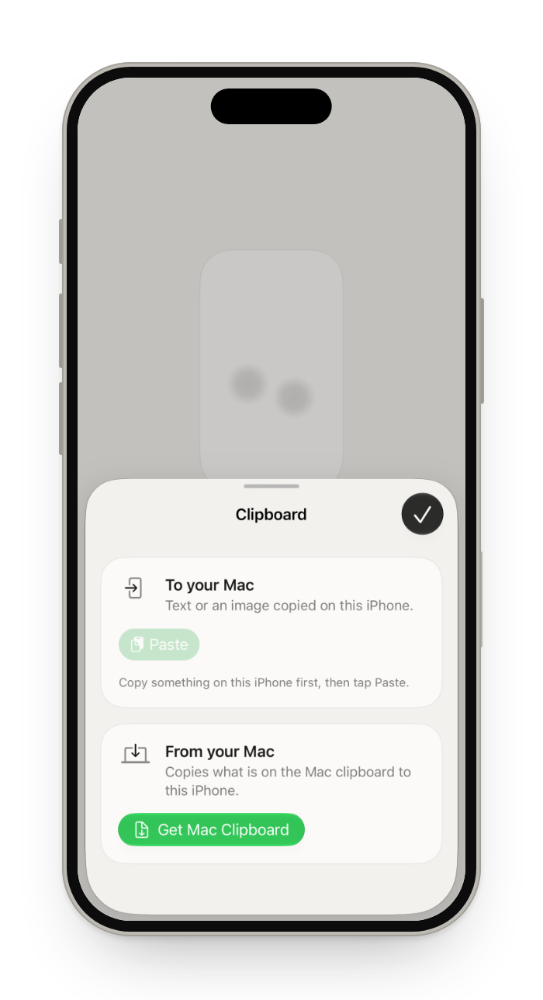<br><b>Clipboard</b><br><sub>Text and images, both ways.</sub></td>
    <td align="center">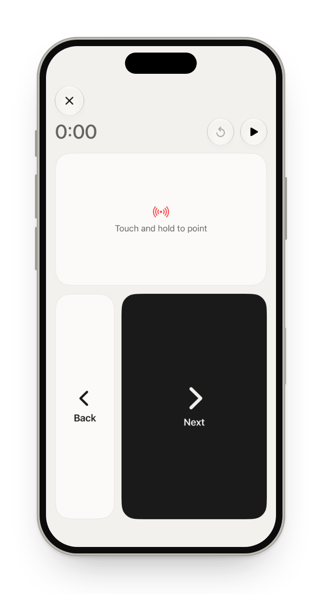<br><b>Present</b><br><sub>Next and Back, a timer, and a laser you steer with one finger.</sub></td>
  </tr>
  <tr>
    <td align="center">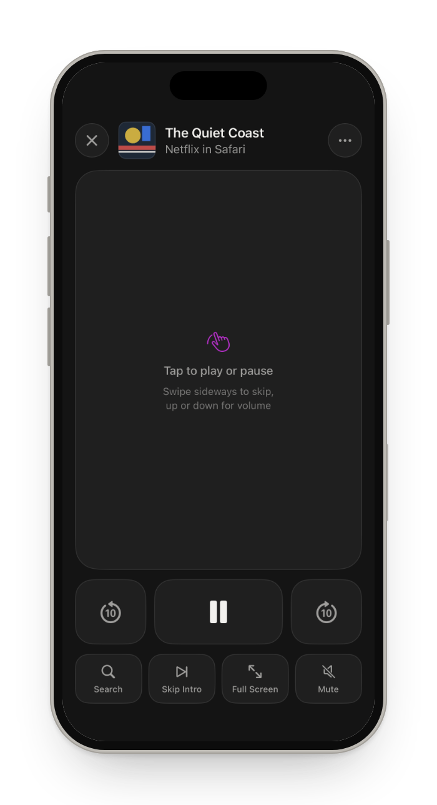<br><b>Remote</b><br><sub>A touch pad like the Siri Remote that follows 11 players, from Netflix to VLC.</sub></td>
    <td align="center">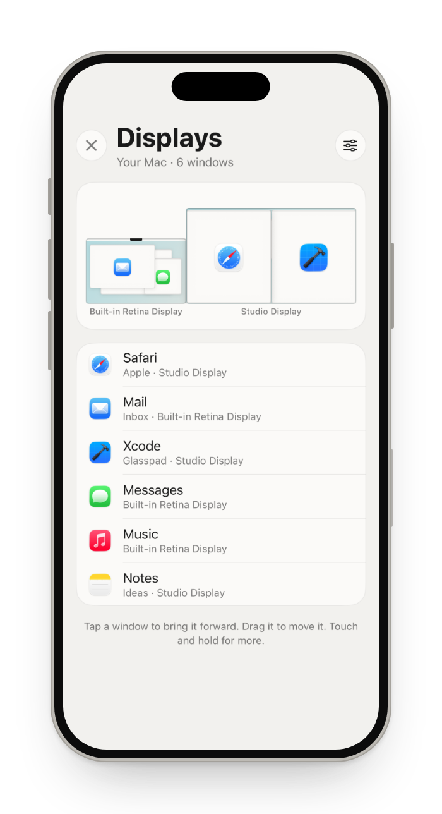<br><b>Displays</b><br><sub>Every display and its windows: move, tile, and set brightness, resolution and Night Shift.</sub></td>
    <td align="center">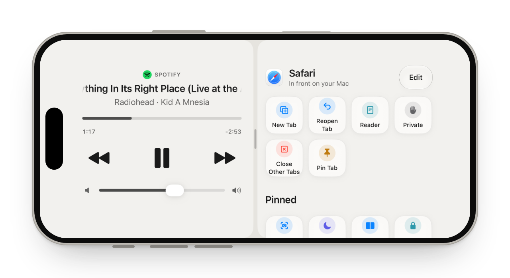<br><b>Layouts</b><br><sub>Up to three modes on one screen.</sub></td>
  </tr>
</table>

**Also included**

| | |
| --- | --- |
| **Split Screen** | Left and Right, Top and Bottom, Quarters or Full Screen, from the phone. |
| **StandBy** | A clock beside Now Playing or your calendar while the iPhone charges. |
| **Without opening the app** | A Control Center control and a Lock Screen widget open the trackpad. Remote, Media and Present keys on the Lock Screen. Siri and Shortcuts open a mode, play or pause, or run a button or macro. |
| **Connection** | Reconnects by itself and says why the Mac is away (asleep, locked, Glasspad off). Wake Mac wakes a Mac with Wake for network access on. On Wi-Fi that keeps devices apart, it tries a direct Wi-Fi link. |
| **More than one Mac** | Pair Another Mac in Settings, then tap to switch. |

<p align="center">
  
  <br><sub><b>39 themes</b>, from plain to glass to a photo of yours.</sub>
</p>

<details>
<summary><b>The Mac side:</b> a small menu bar app</summary>
<br>
<p align="center">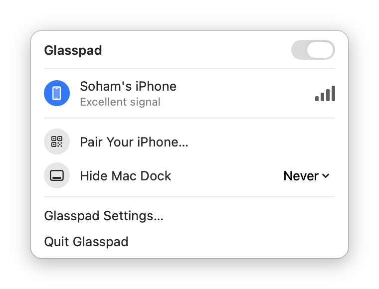</p>
<p align="center"><sub>Drawn by the Mac app's own snapshot tests, with test data.</sub></p>
</details>

## Private by design

- **No account, no Glasspad server.** Your iPhone and Mac talk only over your Wi-Fi.
- **Paired by QR code.** The pairing key lives in the Keychain on both devices. Remove a phone from the Mac menu to revoke it.
- **Encrypted.** Every message uses ChaCha20-Poly1305 with a fresh key per connection, and replays are rejected.
- **What does go out:** Website buttons fetch their site's name and logo, and the Mac may fetch album artwork for Media. Install and renewal use GitHub and Apple.

Details in [SECURITY.md](SECURITY.md) and [ARCHITECTURE.md](ARCHITECTURE.md).

## How it compares

| | Glasspad | Stream Deck Mobile | Remote Mouse | Universal Control |
| --- | :---: | :---: | :---: | :---: |
| Price | Free, everything | 6 keys free, Pro paid | Free with ads, Pro paid | Free, in macOS |
| Open source | Yes, MIT | No | No | No |
| Uses an iPhone | Yes | Yes | Yes | No (Mac and iPad) |
| Mac trackpad gestures | Yes, with haptics | No | Touchpad | Shares the Mac's own |
| App-aware buttons | 70+ apps | Profiles | No | No |
| Works with | Mac only | Mac, Windows | Mac, Windows, Linux | Mac, iPad |
| Install | Terminal, builds with Xcode | App Store | App Store | Built in |

Side by side pages: [Stream Deck Mobile](https://glasspad.sohamaggarwal.com/compare/stream-deck-mobile) · [Remote Mouse](https://glasspad.sohamaggarwal.com/compare/remote-mouse) · [Mobile Mouse](https://glasspad.sohamaggarwal.com/compare/mobile-mouse) · [Coast](https://glasspad.sohamaggarwal.com/compare/coast) · [Universal Control](https://glasspad.sohamaggarwal.com/compare/universal-control)

## FAQ

<details>
<summary><b>What is Glasspad?</b></summary>

Glasspad is a free, open source (MIT) app that turns an iPhone into a trackpad, keyboard, media remote and button deck for a Mac, over Wi-Fi, with no account. It has 11 modes: Trackpad, Keyboard, Media, Dock, Actions, Pinned, Macros, Clipboard, Present, Remote and Displays.
</details>

<details>
<summary><b>Is it really free?</b></summary>

Yes. No ads, accounts, subscriptions or in-app purchases. The code is public under the [MIT license](LICENSE), so no feature in it can be moved behind a paywall later. Installing needs only a free Apple ID.
</details>

<details>
<summary><b>Why is it not on the App Store?</b></summary>

The installer builds the apps from source with Xcode and your own Apple ID instead. That keeps it free in full, with no paid developer account. The [guide](https://glasspad.sohamaggarwal.com/guide) walks through each step.
</details>

<details>
<summary><b>What is the 7-day limit?</b></summary>

Apple lets a free Apple ID install apps on your own iPhone, but they stop opening after 7 days. The Mac app renews the iPhone app over Wi-Fi before that, and Mac Settings > iPhone shows the last renewal.
</details>

<details>
<summary><b>Is it private?</b></summary>

Paired by QR code, encrypted, no account. Your iPhone and Mac talk only over your Wi-Fi; Website buttons fetch their site's logo and the Mac may fetch album art. Details in [SECURITY.md](SECURITY.md).
</details>

<details>
<summary><b>Can I use my iPhone as a mouse or trackpad for my Mac?</b></summary>

Yes. macOS has no built-in way, so you need an app on both devices. Trackpad mode moves the pointer, clicks, scrolls and uses the Mac's own gestures for Spaces and Mission Control. [More](https://glasspad.sohamaggarwal.com/use/iphone-as-mac-trackpad)
</details>

<details>
<summary><b>Is it a Stream Deck alternative?</b></summary>

For many uses, yes: Pinned buttons, per-app Actions, Shortcuts and Macros. A Stream Deck has physical keys you can press without looking and a large plugin library. Glasspad has neither. [More](https://glasspad.sohamaggarwal.com/use/stream-deck-alternative-mac)
</details>

<details>
<summary><b>Does it work with Windows, Android or iPad?</b></summary>

No. Glasspad is an iPhone app and a Mac app, and needs both.
</details>

<details>
<summary><b>Something is not working</b></summary>

See [Troubleshooting](https://glasspad.sohamaggarwal.com/install#troubleshooting) on the install page, then [open an issue](https://github.com/Soham109/glasspad/issues/new/choose).
</details>

More answers in the [guide](https://glasspad.sohamaggarwal.com/guide).

## Build from source

```bash
git clone https://github.com/Soham109/glasspad.git
cd glasspad
xcodegen generate
open Glasspad.xcodeproj
```

Run the **Glasspad Mac** scheme, then **Glasspad iOS** on your iPhone with your Apple ID under Signing. Run the tests with `scripts/test.sh`.

**Developer docs:** [docs/README.md](docs/README.md) (every developer guide) · [ARCHITECTURE.md](ARCHITECTURE.md) (how the code fits together) · [CONTRIBUTING.md](CONTRIBUTING.md) (how to send a change)

## Contributing

Bug reports, ideas and pull requests are welcome. Start with [CONTRIBUTING.md](CONTRIBUTING.md), or pick an issue labeled [good first issue](https://github.com/Soham109/glasspad/labels/good%20first%20issue).

## Learn more

- Guides: [trackpad](https://glasspad.sohamaggarwal.com/use/iphone-as-mac-trackpad) · [keyboard](https://glasspad.sohamaggarwal.com/use/iphone-as-mac-keyboard) · [remote](https://glasspad.sohamaggarwal.com/use/iphone-remote-for-mac) · [Stream Deck alternative](https://glasspad.sohamaggarwal.com/use/stream-deck-alternative-mac) · [split screen](https://glasspad.sohamaggarwal.com/use/mac-split-screen-from-iphone) · [displays](https://glasspad.sohamaggarwal.com/use/control-mac-displays-from-iphone)
- [Every mode, step by step](https://glasspad.sohamaggarwal.com/guide) · [The video on YouTube](https://www.youtube.com/watch?v=6AArTWOADGc) · [Releases](https://github.com/Soham109/glasspad/releases)

## License and credits

[MIT](LICENSE), copyright 2026 [Soham Aggarwal](https://sohamaggarwal.com). Music in the video: "Uplifting Electronic Indie" by WinnieTheMoog, [CC BY 4.0](https://creativecommons.org/licenses/by/4.0).
