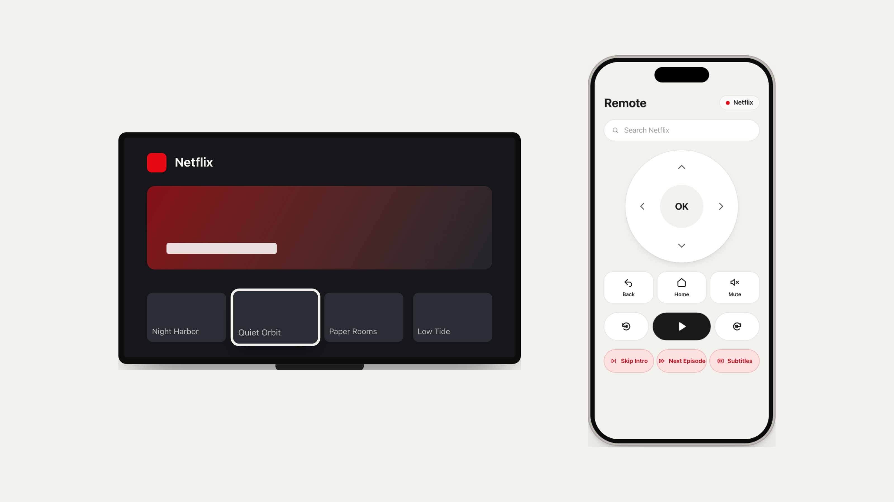

<h1 align="center">Glasspad</h1>

<p align="center"><b>Your iPhone, as a Mac trackpad</b></p>

<p align="center">
A control surface for your Mac. A trackpad you can feel, plus a keyboard, media, your Dock, buttons that follow the app in front, a couch remote and split screen layouts.
</p>

<p align="center">
  
  
  
  
  <a href="https://glasspad.sohamaggarwal.com"></a>
  <a href="https://www.youtube.com/watch?v=6AArTWOADGc"></a>
</p>

<p align="center">
  <picture>
    <source media="(prefers-color-scheme: dark)" srcset="docs/img/hero-dark.png">
    
  </picture>
</p>

<p align="center"><sub>Trackpad beside Actions, one of the split screen layouts.</sub></p>

---

## What it is

Two apps on the same Wi-Fi: a small menu bar app on your Mac and the Glasspad app on your iPhone. The phone becomes whatever you need next to your keyboard.

- **Private.** No accounts, no servers, no tracking. Nothing leaves your network.
- **Free and open source.** MIT licensed.
- **One command to install.**

## What you can do with it

| | |
| --- | --- |
| **Trackpad** | Move, click, drag, scroll, pinch, swipe between Spaces. A small tap you can feel on every click. |
| **Keyboard** | Type and dictate, with shortcut keys. |
| **Media** | Now playing with artwork, scrubbing, volume and brightness. |
| **Dock** | Your Mac's Dock on the phone. Tap to open, hold to quit or hide. |
| **Actions** | Buttons that follow the app in front. Pinned keeps your own: Do Not Disturb, window tiling, Night Shift, Keep Awake, screenshots, macros, Shortcuts and websites. |
| **Remote** | A couch remote for Netflix and YouTube, with keys for each app and typing to search. |
| **Layouts** | Two modes side by side, such as Trackpad and Actions. Drag the divider, use a template or save your own. |
| **Also** | Clipboard between phone and Mac, Present for slides, and themes (Paper, Graphite, Mono, or match your iPhone). |

<p align="center">
  <picture>
    <source media="(prefers-color-scheme: dark)" srcset="docs/img/modes-dark.png">
    
  </picture>
</p>

<p align="center">
  <picture>
    <source media="(prefers-color-scheme: dark)" srcset="docs/img/remote-dark.png">
    
  </picture>
</p>

## Install

You need a Mac on macOS 14 or newer with Xcode (free on the App Store), an iPhone on iOS 18 or newer, a cable for the first install, and a free Apple ID.

Paste this into Terminal:

```bash
curl -fsSL https://raw.githubusercontent.com/Soham109/glasspad/main/install.sh | bash
```

It walks you through each step. Whatever it can do alone, it does; whenever Apple needs you to click or tap, it tells you exactly where and waits until it sees you did it. Safe to run again: finished steps are skipped.

What it does, in order:

1. **Xcode.** Opens the App Store page if Xcode is missing, then accepts its license and one-time setup (asks for your Mac password).
2. **Build tools.** Downloads XcodeGen, the tool that creates the Xcode project.
3. **Source.** Downloads Glasspad into `~/Projects/glasspad` (or updates it).
4. **Your Apple account.** Asks you to sign in to Xcode with your Apple ID and pick your name as the team.
5. **Mac app.** Installs Glasspad in Applications and starts it in the menu bar. You switch on Accessibility for it, so it can move the pointer.
6. **iPhone.** Asks you to plug in and trust the Mac, and turn on Developer Mode. Then it builds and installs the app. The first time, you trust your Apple ID on the phone.
7. **Automatic renewal.** Sets your Mac to renew the iPhone app before the 7-day limit (see the FAQ).

Then pair: click the Glasspad icon in your Mac's menu bar, choose **Pair new iPhone**, and scan the code with the Glasspad app or the iPhone Camera.

## FAQ

**Why does a free Apple ID matter?** Apps you install yourself with a free Apple ID stop opening after 7 days. Glasspad handles this for you: your Mac checks every hour and, once the install is 5 days old, reinstalls the same version over Wi-Fi. You get a notification when it is done. Your Mac needs to be awake and your iPhone on the same Wi-Fi at some point in those two days. A paid developer account lasts a year instead.

**Can I turn automatic renewal off?** Yes: `~/Projects/glasspad/scripts/setup-autorefresh.sh --remove`. Its log is in `~/Library/Logs/Glasspad/refresh.log`.

**Why not the App Store?** Real gestures like Mission Control and Spaces swipes need parts of macOS the App Store does not allow. Each has a fallback that works without them.

**Over the internet?** No. Same Wi-Fi only.

**How fast is it?** Built for the shortest possible delay. Numbers will be published once measured on real devices.

**Can others on my Wi-Fi use it?** Not without the key from your QR code.

**More than one Mac or iPhone?** Pair several Macs and pick one from the mode menu. A Mac follows one iPhone at a time.

## Troubleshooting

**The pointer does not move after a reinstall or update.** macOS can quietly switch Accessibility off when the app is replaced. Open System Settings > Privacy & Security > Accessibility, switch Glasspad off and on again. If that does not help, remove it with the minus button and run the installer again.

**Media shows no song from Spotify.** The first time, macOS asks whether Glasspad may control Spotify. Click OK. If you clicked Don't Allow, open System Settings > Privacy & Security > Automation, find Glasspad and switch Spotify on.

**The iPhone app will not install or open.**
- *Developer Mode:* on the iPhone, Settings > Privacy & Security > Developer Mode (at the bottom) > On. The phone restarts; after unlocking, tap Turn On and enter your passcode.
- *Untrusted developer:* Settings > General > VPN & Device Management > your Apple ID > Trust.

**The iPhone app stopped opening after a week.** Renewal could not reach the phone in time. Bring the phone onto your Mac's Wi-Fi (or plug it in) and run `~/Projects/glasspad/scripts/refresh-phone.sh --now`.

## Security

- Pair by scanning a QR code. The key lives in the Keychain, Apple's encrypted store for secrets, on both devices.
- Every message is encrypted (ChaCha20-Poly1305) with a fresh key per connection, and replays are rejected.
- Remove a phone from the Mac menu to revoke it.

More in [SECURITY.md](SECURITY.md) and [ARCHITECTURE.md](ARCHITECTURE.md).

## Building by hand

```bash
git clone https://github.com/Soham109/glasspad.git
cd glasspad
xcodegen generate
open Glasspad.xcodeproj
```

Run the **Glasspad Mac** scheme, then **Glasspad iOS** on your iPhone with your Apple ID under Signing. Scripts for each piece live in `scripts/`.

## Roadmap

- [ ] First tagged release (0.1.0)
- [ ] Measured latency numbers on real hardware
- [ ] Signed and notarized Mac download
- [ ] Shareable macro files
- [ ] iPad support

## Contributing

Bug reports, ideas and pull requests are welcome. See [CONTRIBUTING.md](CONTRIBUTING.md). To report a security problem, see [SECURITY.md](SECURITY.md).

## Credits

Demo film music: "Uplifting Electronic Indie" by WinnieTheMoog, [CC BY 4.0](https://creativecommons.org/licenses/by/4.0), from [Wikimedia Commons](https://commons.wikimedia.org/wiki/File:Uplifting_Electronic_Indie_by_WinnieTheMoog.ogg). Details in [promo/MUSIC.md](promo/MUSIC.md).

## License

[MIT](LICENSE), copyright 2026 Soham Aggarwal.
