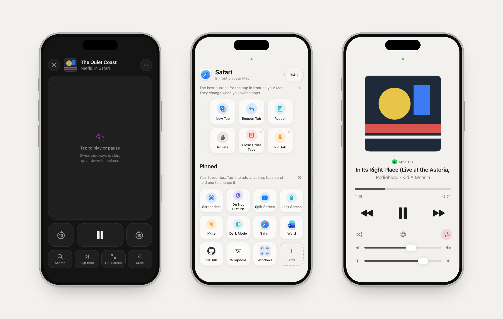
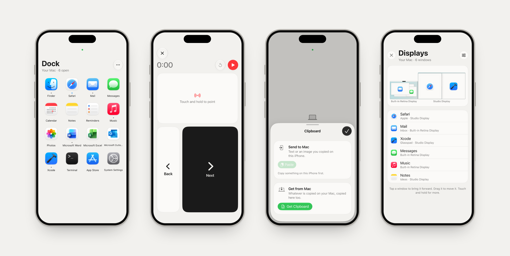
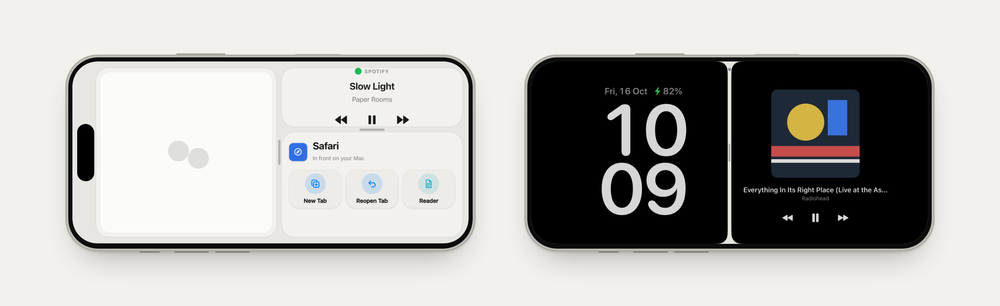
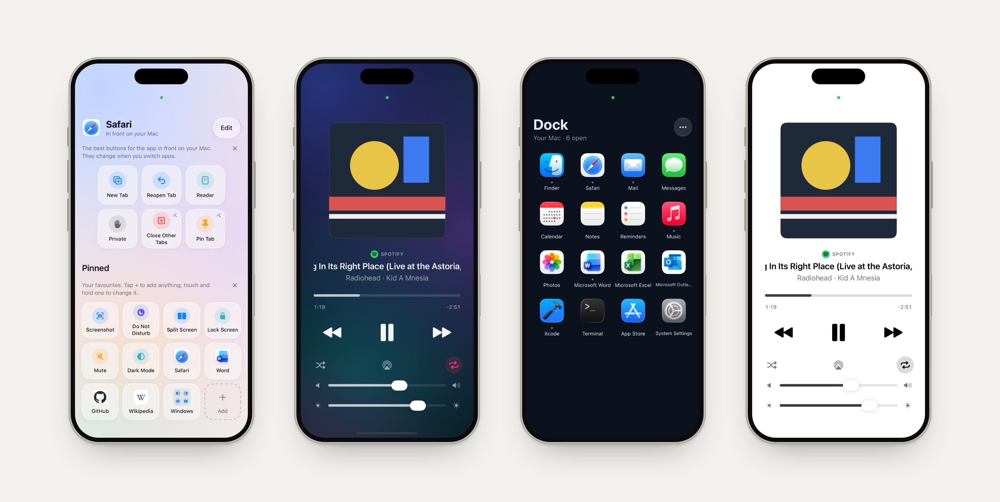

<h1 align="center">Glasspad</h1>

<p align="center"><b>A control surface for your Mac, on your iPhone.</b></p>

<p align="center">
  <a href="https://glasspad.sohamaggarwal.com">Website</a> &middot;
  <a href="https://glasspad.sohamaggarwal.com/guide">Guide</a> &middot;
  <a href="https://www.youtube.com/watch?v=6AArTWOADGc">Film</a>
</p>

<p align="center">
  
  
  
  
</p>

<p align="center">
  
</p>

A small menu bar app on your Mac and an app on your iPhone, on the same Wi-Fi. Free, private and open source.

## Features

| | |
| --- | --- |
| **Trackpad** | Move, click, scroll, pinch and swipe between Spaces, with a tap you can feel on every click. |
| **Keyboard** | Type or dictate. Modifier keys, shortcuts, arrows and F1 to F12. |
| **Media** | What is playing in Spotify, Music or a browser: artwork, scrubbing, sound output, volume and screen brightness. |
| **Dock** | Your Mac's Dock. Tap to open, hold to hide or quit, and hide the Mac's own Dock. |
| **Actions** | Buttons that follow the app in front, for more than 70 apps. |
| **Pinned** | Your own buttons: Do Not Disturb, Night Shift, Keep Awake, Split Screen and window tiling, screenshots, apps, and websites with their real logos. Folders keep them tidy; the Library finds anything. |
| **Macros** | Record steps on your Mac once, replay them with a tap. |
| **Shortcuts** | Run any shortcut from the Shortcuts app on your Mac. |
| **Remote** | A touch pad like the Siri Remote: tap to pause, swipe to skip 10 seconds, up or down for volume. The keys follow the player, and Search types on the Mac. |
| **Present** | Next and Back, a timer, and a laser you steer with one finger. |
| **Clipboard** | Text and images, both ways. |
| **Displays** | Every display and its windows. Move a window to another display or tile it, and set brightness, resolution and Night Shift. |
| **Layouts** | Up to three modes on one screen. The divider rests on thirds and the middle; your layouts sit in the mode menu. |
| **StandBy** | A clock beside Now Playing or your calendar while the iPhone charges, in dim red at night. |
| **Themes** | Eight themes, from Paper to Glass, or follow the system. |
| **Private** | Paired by QR code, encrypted, no account. Nothing leaves your Wi-Fi. |

<p align="center">
  
</p>

<p align="center">
  
</p>
<p align="center"><sub>The layout on the left is drawn. Every other picture is the app.</sub></p>

<p align="center">
  
</p>

## Install

You need a Mac on macOS 14 or later with Xcode (free on the App Store), an iPhone on iOS 18 or later, a cable for the first install, and a free Apple ID. Paste this into Terminal:

```bash
curl -fsSL https://raw.githubusercontent.com/Soham109/glasspad/main/install.sh | bash
```

It does what it can by itself and waits for you where Apple needs a click: Xcode, your Apple ID, Accessibility for the Mac app, and Developer Mode and trust on the iPhone. It is safe to run again. Then click Glasspad in the menu bar, choose **Pair Your iPhone…** and scan the code.

With a free Apple ID, apps you install yourself stop opening after 7 days. Your Mac renews Glasspad over Wi-Fi before then. Every step, and help when something goes wrong, is in the [guide](https://glasspad.sohamaggarwal.com/guide).

## Security

- The pairing key lives in the Keychain on both devices.
- Every message is encrypted (ChaCha20-Poly1305) with a fresh key per connection, and replays are rejected.
- Remove a phone from the Mac menu to revoke it.

More in [SECURITY.md](SECURITY.md) and [ARCHITECTURE.md](ARCHITECTURE.md).

## Building by hand

```bash
git clone https://github.com/Soham109/glasspad.git
cd glasspad
xcodegen generate
open Glasspad.xcodeproj
```

Run the **Glasspad Mac** scheme, then **Glasspad iOS** on your iPhone with your Apple ID under Signing. Scripts for each piece are in `scripts/`. The website is in `web/`, and `web/scripts/readme-images.mjs` makes the pictures above.

## Contributing

Bug reports, ideas and pull requests are welcome. See [CONTRIBUTING.md](CONTRIBUTING.md).

## Credits and license

Film music: "Uplifting Electronic Indie" by WinnieTheMoog, [CC BY 4.0](https://creativecommons.org/licenses/by/4.0). [MIT](LICENSE), copyright 2026 Soham Aggarwal.
