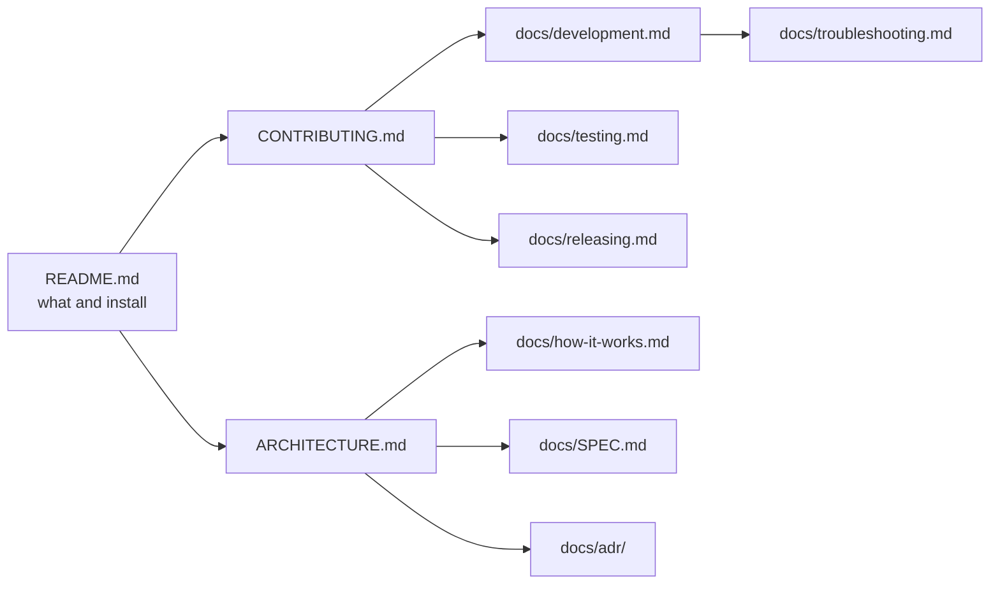

# Glasspad developer docs

Everything for building, changing and releasing Glasspad. Looking for help using the app? See the [guide on the website](https://glasspad.sohamaggarwal.com/guide).

## Start here

| I want to | Read |
| --- | --- |
| Build and run both apps | [Building and running](development.md) |
| Understand how the code fits together | [Architecture](../ARCHITECTURE.md) |
| Know what each mode does on the phone and the Mac | [How each mode works](how-it-works.md) |
| Run the tests and visual checks | [Testing](testing.md) |
| Send a change | [Contributing](../CONTRIBUTING.md) |
| Fix a build or test problem | [Troubleshooting](troubleshooting.md) |
| Cut a release, or understand renewal | [Releasing](releasing.md) |
| Look up a word | [Glossary](glossary.md) |

## Reference

| Document | What it covers |
| --- | --- |
| [SPEC.md](SPEC.md) | The contract: wire format, every message, gestures, synthesis, modes, both apps |
| [SPEC-macros.md](SPEC-macros.md) | The macro model, playback, recording and the Macros messages |
| [SPEC-requests.md](SPEC-requests.md) | Open and done requests between parts of the code |
| [LIVE-CHECK.md](LIVE-CHECK.md) | Every step of the guided check on a real Mac, and the iPhone checklist |
| [Architecture decisions](adr/README.md) | Why key choices were made |
| [Security](../SECURITY.md) | Threat model and how to report a problem |
| [Changelog](../CHANGELOG.md) | What changed in each version |

## Writing docs

[The documentation standard](CONTRIBUTING-DOCS.md): where each doc lives, templates, and style.

## Archive

[Older documents](archive/README.md) kept for history and no longer maintained.

## Map

