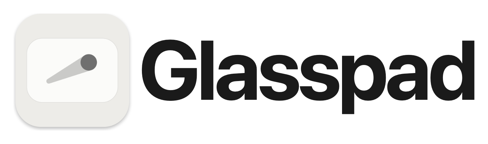
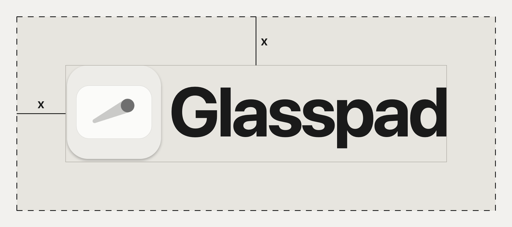
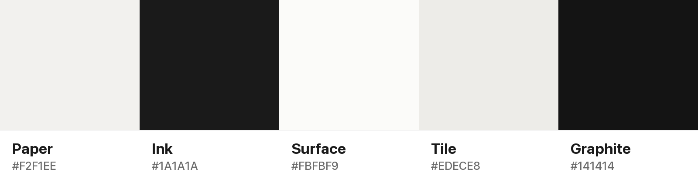

# Glasspad brand

Everything you need to show Glasspad: the icon, the name, colors and real screenshots.
Press kit in one file: [glasspad-press-kit.zip](https://glasspad.sohamaggarwal.com/press/glasspad-press-kit.zip) (also in `web/public/press/`).

## Files

| What | Files | Use it for |
| --- | --- | --- |
| Mac icon (main) | [`icon/glasspad-icon-mac-*.png`](icon/) 1024, 512, 256, 128, 64 | Anywhere you show the app. Transparent, rounded, with its own shadow. |
| iOS icon | [`icon/glasspad-icon-ios-{light,dark}-*.png`](icon/) and [`.svg`](icon/) | App Store style tiles. Square: the system or your layout rounds the corners. |
| Lockup | [`wordmark/glasspad-lockup-{light,dark}.png`](wordmark/) | Headers, slides, articles. `light` is for light backgrounds, `dark` for dark ones. |
| Wordmark | [`wordmark/glasspad-wordmark-{light,dark}.png`](wordmark/) | When the icon is already on screen nearby. |
| Colors | [`colors.json`](colors.json), [`colors.css`](colors.css) | Matching a page or slide to the app. |
| Screenshots | [`screenshots/`](screenshots/) | Articles and reviews. Real captures, see the note below. |
| Social cards | `web/public/og/<page>.png` (1200x630) | One per website page. |
| Fact sheet | [`fact-sheet.md`](fact-sheet.md) | Version, price, requirements, contact. |

The older `icon.svg`, `icon-graphite.svg`, `icon.png` and `preview-*.png` here are written by `scripts/make-icons.swift` and used by the promo film. For press, use the files above.

## Name

- Write it **Glasspad**: one word, capital G only. Not GlassPad, Glass Pad or GLASSPAD.
- Short description: "Your iPhone as a trackpad, keyboard, remote and button deck for your Mac. Free and open source."

## Icon and clear space

- Keep empty space of **x** on every side, where x is half the height of the lockup (or of the icon on its own).
- Smallest size: icon 32 px, lockup 120 px wide.
- On photos, place the icon on a calm area or on a Paper or Graphite panel.

## Colors

| Name | Hex | Use |
| --- | --- | --- |
| Paper | `#F2F1EE` | Light background |
| Ink | `#1A1A1A` | Text and marks on light |
| Surface | `#FBFBF9` | Cards on light |
| Tile | `#EDECE8` | Quiet fills on light |
| Graphite | `#141414` | Dark background (text on it: Paper) |

Glasspad is near black and warm off white on purpose. Color in the app comes from its 39 themes, not from the brand.

**Font:** the system font, `-apple-system` (SF Pro on Apple devices), Bold for the name. SF Pro is Apple's and is not shipped here, so the wordmark comes as images.

## Do and don't

| Do | Don't |
| --- | --- |
| Use the files as they are | Redraw, stretch, rotate or recolor the icon |
| `lockup-light` on light, `lockup-dark` on dark | Put a lockup on a busy photo or a low contrast color |
| Keep the clear space | Add effects: outlines, glows, extra shadows |
| Show real screenshots | Mock up screens or features the app does not have |
| Say "free and open source (MIT)" | Imply Apple made or endorses Glasspad |

## About the screenshots

The iPhone screens are real captures of the app in the iOS Simulator, with the app's built-in sample Mac data (no Mac was connected). The Mac view is drawn by the Mac app's own snapshot tests, with sample data.

## Rebuilding (maintainers)

Run from the repo root on a Mac, with `web/node_modules` installed:

| Step | Command |
| --- | --- |
| iOS icon SVGs | `python3 docs/brand/tools/icon_svg.py` (same numbers as `scripts/make-icons.swift`) |
| Wordmarks | `python3 docs/brand/tools/wordmarks.py` |
| Palette and clear space images | `python3 docs/brand/tools/guide_images.py` |
| Social cards | `python3 docs/brand/tools/og.py` (reads `web/site/pages.ts`) |
| Press kit zip | `python3 docs/brand/tools/press_kit.py` |
