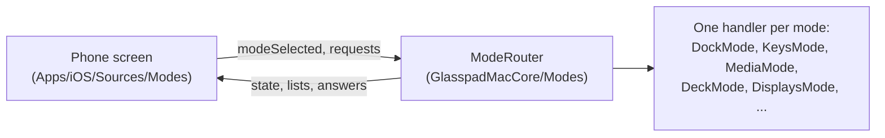
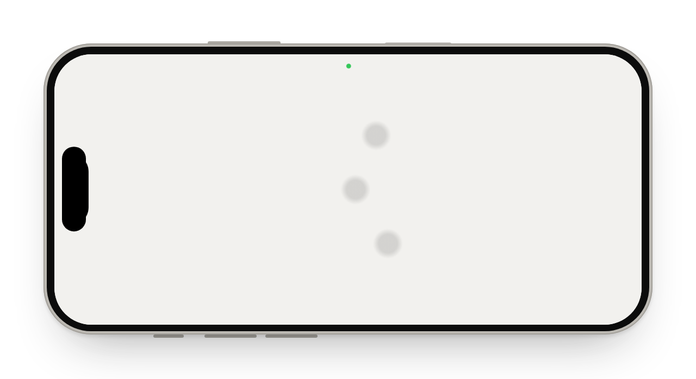

# How each mode works

Every screen on the iPhone is a **mode**. The phone draws it and sends messages. The Mac app does the work. This page says, in plain words, what happens on each side and where the code is. Message names are in [SPEC.md section 5](SPEC.md#5-wire-messages-glasspadkitprotocol).

When a mode opens, the phone sends `modeSelected`. The Mac then starts sending what that mode needs (now playing, the Dock, the front app) and stops when it closes. A layout with several panes also sends `modesShown`, so every pane gets its updates.

| Mode | Shows by default | Screenshot |
| --- | --- | --- |
| [Trackpad](#trackpad) | Yes | [view](img/screens/trackpad.png) |
| [Keyboard](#keyboard) | Yes | [view](img/screens/keyboard.png) |
| [Media](#media) | Yes | [view](img/screens/media.png) |
| [Dock](#dock) | Yes | [view](img/screens/dock.png) |
| [Actions](#actions) | Yes | [view](img/screens/actions.png) |
| [Macros](#macros) | Inside Actions | [Mac recording bar](img/screens/macros-hud.png) |
| [Remote](#remote) | Tool in the mode menu | [view](img/screens/remote.png) |
| [Present](#present) | Tool in the mode menu | [view](img/screens/present.png) |
| [Clipboard](#clipboard) | From Keyboard and the Library | [view](img/screens/clipboard.png) |
| [Displays](#displays) | Tool in the mode menu | [view](img/screens/displays.png) |
| [StandBy](#standby-clock-now-playing-calendar) | In layouts | [view](img/screens/standby.png) |
| [Layouts](#layouts) | Mode menu | [view](img/screens/layouts.png) |

## Trackpad

**Phone.** A plain surface with a soft dot under each finger. It sends where every finger is, many times a second, and plays a haptic tap on each click.

**Mac.** Turns finger movement into pointer movement, clicks, scrolling, pinch, and swipes between Spaces or into Mission Control. It reads the Mac's own trackpad settings (tracking speed, natural scrolling, tap to click) and uses the Mac's own acceleration curve, so it feels like the built-in trackpad.

**Code.** `TrackpadSurfaceView.swift`, `Haptics.swift` (phone); `GestureRecognizer`, `TouchPipeline`, `MotionScheduler`, `EventSynthesizer` (Mac). Full path: [ARCHITECTURE.md](../ARCHITECTURE.md#the-path-of-a-touch).

 

## Keyboard

**Phone.** Glasspad's own Mac-style keyboard, plus a text field for dictation. Typed text streams as you type. Modifier keys, arrows, Escape, Tab and F1 to F12 send key presses.

**Mac.** Text arrives as Unicode key events, so any language works. A shortcut like Command-T presses the key that types "t" on **this Mac's** keyboard layout, so shortcuts work on non-US layouts too.

**Code.** `KeysMode.swift`, `MacKeyboardView.swift` (phone); `KeysMode`, `KeyLayout`, `KeyboardSynth` (Mac).

## Media

**Phone.** What is playing, with artwork, a scrubber, shuffle and repeat, the sound output, volume and display brightness.

**Mac.** Reads now playing from macOS through a small helper ([ADR 0003](adr/0003-now-playing-through-perl.md)). Spotify and Music can also be read and controlled with AppleScript, which asks for the optional Automation permission. Volume uses CoreAudio.

**Code.** `MediaMode.swift`, `MediaStore.swift` (phone); `MediaMode`, `NowPlayingAdapter`, `Apps/Mac/Helpers/NowPlayingHelper.m` (Mac).

## Dock

**Phone.** The Mac's Dock in the same order, with running dots. Tap to open, hold for Quit, Hide or Show in Finder. A switch can hide the Mac's own Dock.

**Mac.** Reads the Dock's preferences and the running apps. Icons are sent once at 384 pixels and cached by the app and when it last changed, so later visits cost almost nothing.

**Code.** `DockMode.swift` (phone); `DockMode`, `AppLauncher`, `MacDockHider` (Mac).

## Actions

**Phone.** One screen with two parts: buttons for the app in front (from the starter library or your own), and **Pinned**, your own buttons and folders. **+** opens the Library: Mac controls, apps, websites, shortcuts and macros.

**Mac.** Runs each button directly: a keystroke, an app, a website, a shortcut, a macro, or a Mac control such as Do Not Disturb, Night Shift or window tiling. The buttons live on the Mac in `deck.json`. The phone can edit them but can never add a shell command.

**Code.** `ActionsMode.swift`, `DeckEditor.swift`, `ActionLibrary.swift` (phone); `DeckMode`, `MacControls`, `WindowTiling` (Mac); `StarterLibrary` (GlasspadMacros).

## Macros

**Phone.** The Mac's macros and the set for the app in front. Tap to run, with progress.

**Mac.** Records steps (keys, clicks, typing, apps, waits) once and plays them back. Shortcuts from the Shortcuts app run the same way. Full model: [SPEC-macros.md](SPEC-macros.md).

**Code.** `MacrosMode.swift` (phone); `MacroCoordinator` (Mac); the `GlasspadMacros` package.

## Remote

**Phone.** A touch pad like the Siri Remote: tap to play or pause, swipe sideways to skip 10 seconds, up or down for volume. Its keys change with the player in front, and Search types on the Mac.

**Mac.** Sends now playing and the front app. Each key becomes the right media command or keystroke for that player (YouTube, Netflix, Apple TV, Spotify and others). One-off Mac controls arrive as `remoteSystem`.

**Code.** `RemoteMode.swift` (phone); `RemoteKeymap` (GlasspadKit); `ModeRouter`, `DeckMode` (Mac).

## Present

**Phone.** Big Next and Back buttons, a talk timer, and a laser you steer with one finger.

**Mac.** Next and Back press the arrow keys. The laser is a dot in a transparent, click-through window on the slides' display.

**Code.** `PresentMode.swift`, `PresentClock.swift` (phone); `PresentMode`, `LaserScreen` (Mac).

## Clipboard

**Phone.** Send the phone's clipboard to the Mac, or pull the Mac's to the phone. Text and images.

**Mac.** Reads and writes the pasteboard. Text over 2 MB and images over 100 million pixels are refused whole, never cut, and the phone says why.

**Code.** `ClipboardMode.swift` on both sides.

## Displays

**Phone.** Every display and its windows, drawn to scale like System Settings. Tap a window to bring it forward, drag it to move it, hold for tiling and Split Screen. Tap a display for brightness, resolution, Night Shift, mirroring and arrangement.

**Mac.** Reads the window list four times a second while the screen is open. Moves windows through Accessibility. Display changes are temporary for 15 seconds unless you choose Keep, like macOS's own "Keep these display settings?".

**Code.** `DisplaysMode.swift`, `DisplaysStore.swift`, `ArrangeSheet.swift` (phone); `DisplayGeometry` (GlasspadKit); `DisplaysMode`, `WindowMover`, `SplitScreen` (Mac).

## StandBy: Clock, Now Playing, Calendar

**Phone.** Glanceable screens for a charging phone, like iOS StandBy. Always black, dim red at night, and the content shifts a little each minute so nothing burns in.

**Mac.** Now Playing uses the Media stream. Clock and Calendar need nothing from the Mac. Calendar reads the phone's own calendar, after you tap to allow it.

**Code.** `StandByMode.swift`, `StandByClock.swift`, `StandByCalendar.swift` (phone); `StandBy.swift` (GlasspadKit).

## Layouts

**Phone.** One to three modes on one screen. Drag the divider; it rests on thirds and the middle. A layout reports its most demanding pane to the Mac with `modeSelected`, then every pane with `modesShown`.

**Code.** `Apps/iOS/Sources/Layouts`; `ScreenLayout`, `DividerMath`, `LayoutWirePlan` (GlasspadKit).

## What runs on every mode

| Feature | Phone | Mac |
| --- | --- | --- |
| Themes | `Palette` reads colors from `ThemeCatalog`. Contrast is tested for every theme. | Not involved |
| Power | `PowerPolicy` pauses extras when the phone is warm or in Low Power Mode. Pointer traffic is never slowed. | Not involved |
| Status | Shows banners from `macStatus` (for example, Accessibility off) | `MacStatusReporter` sends it after the handshake and on each change |
| Lock Screen and Siri | Live Activity (`Apps/iOS/Sources/Live`), App Intents (`Apps/iOS/Sources/Intents`) | Same messages as the app |
