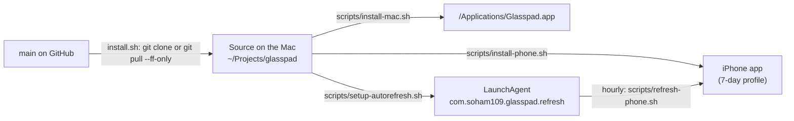
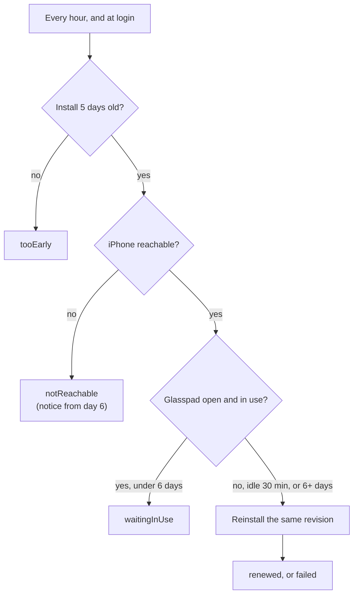

# Releasing

How versions, the changelog, tags and GitHub releases work, and how the app reaches a person's iPhone and stays there.

## How people get Glasspad



| Fact | Why it matters |
| --- | --- |
| There are no prebuilt binaries. Each person's Mac builds both apps from source with their own free Apple ID. | Releases have no assets to upload. |
| `install.sh` installs **`main` at its newest commit**, not the latest tag. | `main` must always be releasable. A tag only marks a version. |
| Running the installer again updates both apps when `main` moved, and skips what is current. | That is how people update. |
| Renewal reinstalls the **same** revision that was installed. It never updates. | An unfinished change never reaches a phone by itself. |

## Versions

One version for both apps, in [semantic versioning](https://semver.org): `MAJOR.MINOR.PATCH`.

| File | Field | Read by |
| --- | --- | --- |
| `project.yml` | `MARKETING_VERSION` | Xcode builds of both apps and the widgets; `scripts/build-mac.sh` |
| `CITATION.cff` | `version`, `date-released` | GitHub's "Cite this repository" |
| `web/site/pages.ts` | `VERSION` | The website |
| `SECURITY.md` | Supported versions table | People reporting a problem |

`CURRENT_PROJECT_VERSION` (the build number) stays `1`.

## Changelog

[CHANGELOG.md](../CHANGELOG.md) follows [Keep a Changelog](https://keepachangelog.com).

- Every change people will notice adds a line under `## [Unreleased]`, in the same pull request.
- Group lines under `### Added`, `### Changed`, `### Fixed`, `### Removed`.
- Write for the person using the app: what they see, in plain words. Bold the mode or area first, for example `- **Remote:** ...`.

## Cutting a release

Run from an up-to-date `main` with a clean working tree.

1. **Check.** `scripts/test.sh` passes, `scripts/build-mac.sh` builds, and the iPhone app builds (`scripts/visual-check.sh` or Xcode).
2. **Changelog.** Rename `## [Unreleased]` to `## [X.Y.Z] - YYYY-MM-DD` and add a fresh empty `## [Unreleased]` above it.
3. **Version.** Set `X.Y.Z` in every file in the [table above](#versions).
4. **Commit.** `Version X.Y.Z: changelog and app version`.
5. **Tag** (annotated) and push:

   ```bash
   git tag -a vX.Y.Z -m "Glasspad X.Y.Z"
   git push origin main vX.Y.Z
   ```

6. **GitHub release.** Use that version's changelog section as the notes:

   ```bash
   awk '/^## \[X.Y.Z\]/{f=1;next} /^## \[/{f=0} f' CHANGELOG.md > /tmp/notes.md
   gh release create vX.Y.Z --title "Glasspad X.Y.Z" --notes-file /tmp/notes.md
   ```

7. **Check the release** at [github.com/Soham109/glasspad/releases](https://github.com/Soham109/glasspad/releases).

### After the release

Freeze the wire, so later builds keep talking to this one ([ADR 0005](adr/0005-additive-protocol-and-frozen-wire.md)):

```bash
cd Packages/GlasspadKit
GLASSPAD_RECORD_WIRE="$PWD/Tests/GlasspadKitTests/WireGolden_<yyyy_mm_dd>.swift" swift test --filter WireGolden
```

Add the new list to `WireGoldenTests.versions` and commit it as `Tests: freeze the wire as X.Y.Z wrote it`.

## Phone install and renewal

A free Apple ID signs apps with a provisioning profile (Apple's permission slip for one app on one device) that expires after 7 days. The Mac renews it before then ([ADR 0001](adr/0001-free-apple-id-with-automatic-renewal.md)).



| Piece | Where |
| --- | --- |
| What was installed: revision, device, team, repo, time | `~/Library/Application Support/Glasspad/phone-install.env` (written by `scripts/install-phone.sh`) |
| The hourly job | `~/Library/LaunchAgents/com.soham109.glasspad.refresh.plist`, made by `scripts/setup-autorefresh.sh` (`--remove` takes it away) |
| Each run's outcome | `refresh-status.json` next to `phone-install.env`, shown in the Mac's Settings > iPhone |
| Whether the phone is in use | `phone-session.json`, written by the Mac app when a phone connects and leaves |
| Log | `~/Library/Logs/Glasspad/refresh.log` |
| When the install expires | iPhone Settings > About, read from the app's own profile (`ProvisionExpiry`) |

Renew now, without waiting for day 5:

```bash
scripts/refresh-phone.sh --now
```
