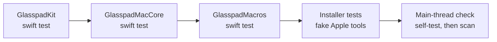

# Testing

Five kinds of checks. The first runs everywhere; the others are run by hand when a change needs them.

| Check | Command | Runs in CI | Needs |
| --- | --- | --- | --- |
| [Unit and integration tests](#scriptstestsh) | `scripts/test.sh` | Yes, every push and pull request | Nothing beyond Swift |
| [Mac app tests](#mac-app-tests) | `swift test --package-path Apps/Mac ...` | No | Nothing beyond Swift |
| [Visual check, iPhone](#visual-check-iphone) | `scripts/visual-check.sh` | No | Xcode and an iPhone simulator |
| [Visual check, Mac](#visual-check-mac) | `scripts/visual-check-mac.sh` | No | Nothing beyond Swift |
| [Live check](#live-check) | `scripts/live-check.sh` | No | A real Mac (and iPhone for the second half) |

## scripts/test.sh



| Step | What it checks |
| --- | --- |
| Each package in `Packages/` | swift-testing suites (`import Testing`). Every package runs even if one fails; the script fails at the end. |
| `scripts/tests/installer-test.sh` | `install.sh` and the renewal scripts, piped into bash with a home folder that has spaces, against fakes in `scripts/tests/stubs` (xcrun and devicectl, xcodebuild, xcodegen, security, openssl, codesign, sudo, curl, brew, launchctl, open, osascript, pkill). No iPhone or Apple account needed. |
| `scripts/check-main-thread.py` | No blocking call on the main thread ([ADR 0004](adr/0004-main-thread-never-blocks.md)). Runs its own self-test first. |

Useful forms:

```bash
scripts/test.sh                        # everything
scripts/test.sh --filter ShownCount    # extra arguments go to every swift test
python3 -I scripts/check-main-thread.py   # the main-thread check alone
bash scripts/tests/installer-test.sh      # the installer tests alone
```

On CI only (`CI` set), a failed test gets one more run on its own, at most five tests, and the log prints `RETRIED ON CI AND PASSED`. Hosted machines stall at random and trip timing tests. A local run never retries.

### What the package tests cover

| Area | Example suites |
| --- | --- |
| Wire format and compatibility | `ProtocolTests`, `WireGoldenTests`, `CompatibilityTests` |
| Encryption and pairing | `CryptoTests`, `PairingPatternTests`, `PairingFlowTests` |
| Connection over a real loopback | `TransportTests`, `ConnectivityTests`, `LoopbackEndToEndTests` |
| Gestures and feel | `GestureTests`, `FeelTests`, `PrecisionTests`, `PipelineTests`, `GapHidingTests` |
| Mac modes, through the real router | `ModesTests`, `DeckModeTests`, `DisplaysModeTests`, `RemoteRouterTests` |
| Phone rules | `ScreenLayoutTests`, `PowerPolicyTests`, `ThemeContrastTests`, `StandByTests` |
| Macros | `EngineTests`, `RecorderTests`, `PlayerTests`, `StarterDefaultsTests` |

### Rules for tests

- Never post events into the live session. Build events and check their fields, or use the fakes (`ModeFakes.swift`, `LiveCheckFakes.swift`, `Packages/GlasspadMacros/Tests/GlasspadMacrosTests/Fakes.swift`).
- Gesture changes need a scripted touch sequence test.
- Timing tests must allow a slow, busy machine.

### Frozen wire messages

`WireGoldenTests` checks that every message an older release wrote still reads, and is written back the same. To freeze the wire after a release:

```bash
cd Packages/GlasspadKit
GLASSPAD_RECORD_WIRE="$PWD/Tests/GlasspadKitTests/WireGolden_<yyyy_mm_dd>.swift" swift test --filter WireGolden
```

Then add the new list to `WireGoldenTests.versions`. See [releasing](releasing.md#after-the-release).

## Mac app tests

`Apps/Mac` is its own SwiftPM package with XCTest tests: the Mac's wording, the menu bar status, and a test that draws the living pairing code and reads it back with Vision.

```bash
source scripts/toolchain.sh
swift test --package-path Apps/Mac --scratch-path "$GP_BUILD_ROOT/GlasspadMacDebug" ${GP_SWIFT_FLAGS[@]+"${GP_SWIFT_FLAGS[@]}"}
```

They are not part of `scripts/test.sh` or CI yet, so run them when you touch `Apps/Mac`.

## Visual check, iPhone

Takes a screenshot of every screen in `scripts/visual-screens.txt`, in five themes (Paper, Graphite, Mono, Blue tinted in dark, Grain), in the simulator, and compares them with a baseline. It never touches a real iPhone or the Mac's screen.

```bash
xcrun simctl create GP-guard "iPhone 17 Pro"          # once
scripts/visual-check.sh --baseline ~/gp-baseline --record   # before your change
scripts/visual-check.sh --baseline ~/gp-baseline            # after: lists what changed
```

| Option | Does |
| --- | --- |
| `--only REGEX` | Only screens whose name matches, for example `--only '^remote'` |
| `--themes "paper graphite"` | Fewer themes |
| `--app PATH` | Use a built `Glasspad.app` instead of building |
| `--resume` | Keep shots already taken and take only the missing ones |
| `--sim NAME` | Another simulator (default `GP-guard`); it is booted and shut down again |
| `GLASSPAD_MAX_LOAD=<n>` | Before each launch, wait while the Mac's load average is over n |

Exit codes: 0 nothing changed beyond its allowance, 1 something changed, 2 setup error. Side by side pictures of each change go to `build/visual/now` (or `--out`). Each screen's allowance is the second column of `scripts/visual-screens.txt` (default 0.3% of pixels).

## Visual check, Mac

Draws the popover, welcome, every Settings pane and the Live Check window, light and dark, off screen with the snapshot harness in `Apps/Mac/Tests`. No window opens and nothing is clicked.

```bash
scripts/visual-check-mac.sh --baseline ~/gp-mac-baseline --record   # before
scripts/visual-check-mac.sh --baseline ~/gp-mac-baseline            # after
```

To only draw the pictures (for a pull request), without comparing:

```bash
source scripts/toolchain.sh
GLASSPAD_SNAPSHOTS=1 GLASSPAD_SNAPSHOT_DIR=/tmp/gpmac swift test --package-path Apps/Mac --scratch-path "$GP_BUILD_ROOT/GlasspadMacDebug"
```

## Live check

Some features can only be seen working on a real Mac: Control Center, Night Shift, window moves, display changes. The live check runs each one through the same code the phone reaches, reads back what it can, asks you about the rest, and puts the Mac back after each step.

```bash
scripts/live-check.sh --install              # build and install this checkout first
scripts/live-check.sh --include-disruptive   # also Lock Screen, Sleep, Empty Trash, Eject All
```

The report goes to `~/Library/Logs/Glasspad/live-check-<date>.md`. Every step, wait and restore is in [LIVE-CHECK.md](LIVE-CHECK.md), with the iPhone checklist.

## Testing the real installer

| What | How |
| --- | --- |
| The installer from GitHub, into a scratch folder | `GLASSPAD_HOME=<scratch folder> bash -c "$(curl -fsSL https://raw.githubusercontent.com/Soham109/glasspad/main/install.sh)"` |
| A local copy of the installer and source | `GLASSPAD_REPO_URL=<path to a clone> bash < install.sh` |
| The Mac only, without a phone | Add `GLASSPAD_SKIP_PHONE=1` |
| A run with nobody at the terminal | Add `</dev/null`. A step that needs a person stops with exit code 2 and says what to do. |

Installer options are listed at the top of [install.sh](../install.sh). The October 2026 run log is in the [archive](archive/INSTALL-TEST.md).
